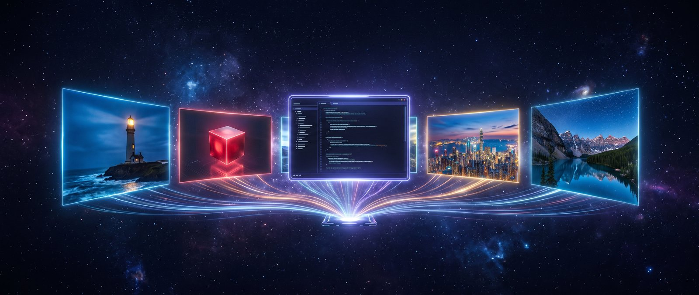
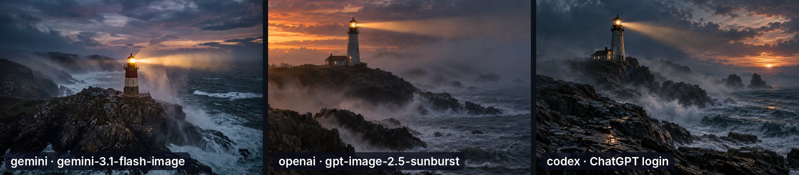
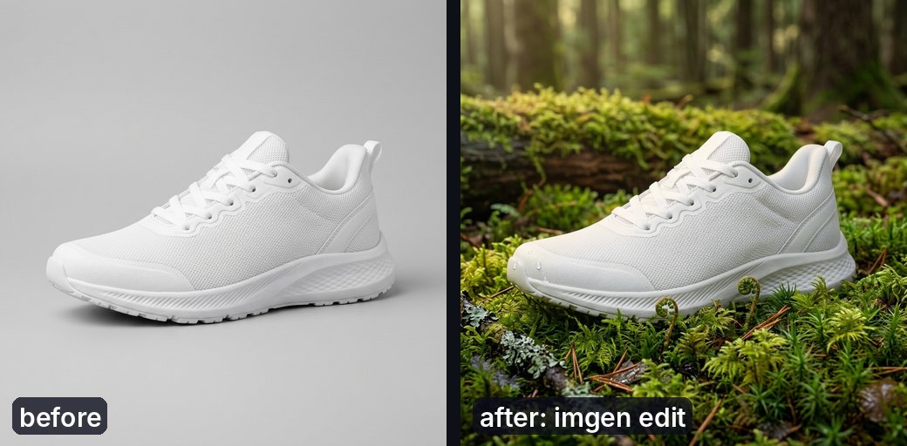
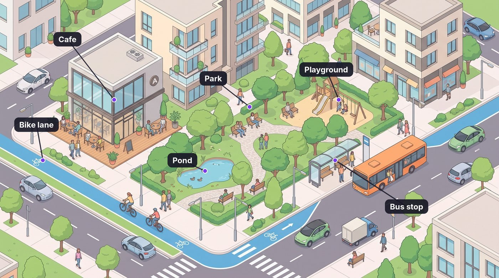

<p align="center">
  
</p>

<h1 align="center">imgen</h1>

<p align="center">
  <a href="https://github.com/joshuafuller/imgen/releases/latest"></a>
  <a href="go.mod"></a>
  <a href="LICENSE"></a>
  <a href="docs/providers.md"></a>
  <a href="docs/mcp.md"></a>
  <a href="docs/security.md"></a>
  <a href="https://github.com/joshuafuller/imgen/releases/latest"></a>
</p>

<p align="center">
  <b>One CLI for every image model.</b> Gemini, OpenAI, Codex, Ideogram, Recraft, FLUX, Replicate, fal, Higgsfield, your local GPU, or any script.<br>
  A single Go binary with one dependency. MCP server built in.
</p>

```sh
imgen gen -r 4K -a 16:9 "a lone lighthouse at dusk, no text"
# /path/to/lone-lighthouse-at-dusk-no-text.jpg
```

## Why imgen

- **New models work on day one.** `imgen models` asks each API what exists now, `-m latest` picks the newest, and any model ID passes straight through.
- **Every knob.** 4K on Gemini; exact sizes, quality and real transparency on OpenAI; anything else with `--set key=value`.
- **Bring your own backend.** A local OpenAI-compatible server is three lines of config. ComfyUI or a diffusers script is a small JSON plugin in any language.
- **Use your ChatGPT plan.** The `codex` provider makes images through your Codex login. No API key, no API bill.
- **Made for scripts and agents.** Paths on stdout, `--json` results, stable exit codes, a Claude Code skill, and `imgen mcp`.
- **Safe defaults.** Keys stay in a private file, files are never overwritten, spend can be capped per day, and every response is validated.

## Quick start

```sh
go install github.com/joshuafuller/imgen/cmd/imgen@latest
imgen init                                   # save your API keys (mode 0600)
imgen doctor                                 # ✓ ready, ○ not set up, ✗ problem

imgen gen "a red cube on a white table"      # Gemini by default
imgen edit --last "make the cube blue"       # edit the image you just made
imgen gen -p openai -r 1024x1024 -b transparent -f png "flat rocket app icon"
imgen gen --json "a red cube" | jq -r '.files[0].path'
```

Unix-friendly: `-i -` and `-o -` move image bytes through pipes, and on kitty, iTerm2, WezTerm or a sixel terminal the result shows inline.

```sh
cat photo.png | imgen edit -i - -o - "make it night" | imgen upscale --local -i - -o - > night.png
```

`imgen qr https://example.com "a calm koi pond"` turns a link into QR code art and checks that it still scans ([recipe](docs/recipes.md#qr-code-art)).

Paths of saved files go to stdout. Model, time and estimated cost go to stderr (one line such as `✓ 1 image · gemini-3.1-flash-image · 8.8s · ~$0.067` on a terminal). `imgen gen -h` shows every flag, grouped, with examples. Short flags have long names too (`-a`/`--aspect`, `-p`/`--provider`, ...). More in [Getting started](docs/getting-started.md).

On a terminal, a bare `imgen` (or `imgen -i`) starts an [interactive session](docs/interactive.md). Type a prompt, then type what to change, and imgen edits the last image:

```sh
imgen -i -p openai     # imgen › a red fox in snow   then   imgen › make it bluer
```

## What people use it for

<p align="center">
  
</p>

```sh
P="a lone lighthouse on a rocky point at dusk, warm beam cutting through sea mist, cinematic"
imgen gen -p gemini -m gemini-3.1-flash-image -r 2K -a 4:3 "$P"
imgen gen -p openai -m gpt-image-2.5-sunburst -r 1536x1024 -q high "$P"
imgen gen -p codex "$P"
```

`imgen compare -p gemini,openai,codex "$P"` does the same in one call and adds a labelled sheet.

<table>
<tr>
<td width="50%" valign="top">

### 🚀 App icons with real transparency

```sh
imgen gen -p openai -r 1024x1024 -q high \
  -b transparent -f png --name icon \
  "glossy 3D app icon of a paper rocket, no text"
```

</td>
<td width="50%"></td>
</tr>
<tr>
<td valign="top">

### 👟 Product shots, restaged

```sh
imgen gen -a 1:1 --name before \
  "studio photo of a white running sneaker"
imgen edit -i before.jpg --name after \
  "same sneaker on a mossy forest floor"
```

</td>
<td></td>
</tr>
<tr>
<td valign="top">

### ☕ Logo exploration in one call

```sh
imgen gen -p openai -n 4 --grid --name logo \
  "minimal logo mark: flame merged with a coffee bean"
```

</td>
<td></td>
</tr>
<tr>
<td valign="top">

### 🗺️ Diagrams with perfect labels

```sh
imgen gen -r 2K -a 16:9 --name plate \
  "isometric city block, cafe, park, bus stop, no text"
# then draw the labels in code
```

</td>
<td></td>
</tr>
<tr>
<td valign="top">

### ⚔️ Animated game characters

```sh
imgen gen -p openai -b transparent -f png --name hero \
  "pixel-art knight, side view, full body, no background"
# then animate it: examples/sprite/ makes a
# seamless walk loop, sheet and atlas
```

</td>
<td></td>
</tr>
</table>

### 🌌 Ultrawide wallpapers

```sh
imgen gen -r 4K -a 21:9 "aurora over a frozen fjord, calm, no text"
```

For a 5120x1440 (32:9) grain-free desktop, use the built-in profile: `imgen gen --profile wallpaper "..."`.

<p align="center"></p>

Every image in this README was made with imgen. More worked examples are in [Recipes](docs/recipes.md).

## Providers

| `-p` | Key | Best for |
|---|---|---|
| `gemini` (default) | `GEMINI_API_KEY` | fast, native 4K, wide ratios, strong edits |
| `openai` | `OPENAI_API_KEY` | exact sizes, quality levels, real transparency, masked edits |
| `codex` | Codex CLI login | no API bill |
| `ideogram` | `IDEOGRAM_API_KEY` | text inside images |
| `recraft` | `RECRAFT_API_KEY` | SVG and vector output |
| `bfl` | `BFL_API_KEY` | FLUX models from Black Forest Labs |
| `replicate` | `REPLICATE_API_TOKEN` | any model on Replicate (`-m owner/name`) |
| `fal` | `FAL_KEY` | any model on fal.ai (`-m fal-ai/...`) |
| `higgsfield` | `HIGGSFIELD_API_KEY` + `HIGGSFIELD_API_SECRET` | Higgsfield image models |
| your own | none, or your choice | local servers and exec plugins ([Extending](docs/extending.md)) |

Gemini, OpenAI and Codex are tested with real images. The other API providers are checked in CI against each vendor's official OpenAPI spec. Details per provider: [Providers](docs/providers.md).

## Use it from an AI agent

- **Claude Code skill:** `make install-skill` links [`skills/imgen`](skills/imgen/SKILL.md) into `~/.claude/skills/imgen`. The agent calls `imgen` from the shell and loads reference pages only when it needs them.
- **MCP server:** for apps with no shell, run `imgen mcp`. Tool paths are confined to a workspace folder, and spend, calls and disk use are capped per session. See [MCP server](docs/mcp.md).

## Documentation

| Page | What it covers |
|---|---|
| [Getting started](docs/getting-started.md) | Install, keys, `doctor`, first image and edit |
| [Interactive mode](docs/interactive.md) | A terminal session: prompt, refine, pick |
| [CLI reference](docs/cli.md) | Every command and flag, output contract, exit codes, environment |
| [Providers](docs/providers.md) | Keys, models, sizes and support per backend |
| [Configuration](docs/configuration.md) | Rules file, styles, profiles, budget, history and cache |
| [Recipes](docs/recipes.md) | Icons, product shots, diagrams, wallpapers, batches |
| [Interop recipes](docs/interop.md) | Pipes, ImageMagick, ffmpeg, jq, xargs, fzf, history |
| [MCP server](docs/mcp.md) | Agent setup, tools and safety policy |
| [Local models](docs/local-models.md) | ComfyUI and Qwen-Image-2.1 on your own GPU |
| [Extending](docs/extending.md) | Local servers, exec plugins, native Go providers |
| [Architecture](docs/architecture.md) | Components, request flow, package map |
| [Security](docs/security.md) | Threat model, controls and review history |
| [Troubleshooting](docs/troubleshooting.md) | Errors and fixes |

## Install

```sh
go install github.com/joshuafuller/imgen/cmd/imgen@latest
```

Or use the install script, which verifies the checksum:

```sh
curl -fsSL https://raw.githubusercontent.com/joshuafuller/imgen/main/packaging/install.sh | sh
```

Prebuilt binaries for Linux, macOS and Windows (amd64 and arm64) are on [Releases](https://github.com/joshuafuller/imgen/releases).

Then add your keys with `imgen init`, or put them in `~/.config/imgen/env` (mode 600). imgen reads that file itself, so the keys never reach your shell or other programs. Codex needs no key.

## Development

```sh
make test    # go test -race ./...
make check   # the full gate: lint, vulns, secrets, SAST, workflow audit
```

Tests use fake servers and fake processes, so they run offline. Report security issues as described in [SECURITY.md](SECURITY.md).

## License

MIT. See [LICENSE](LICENSE).
