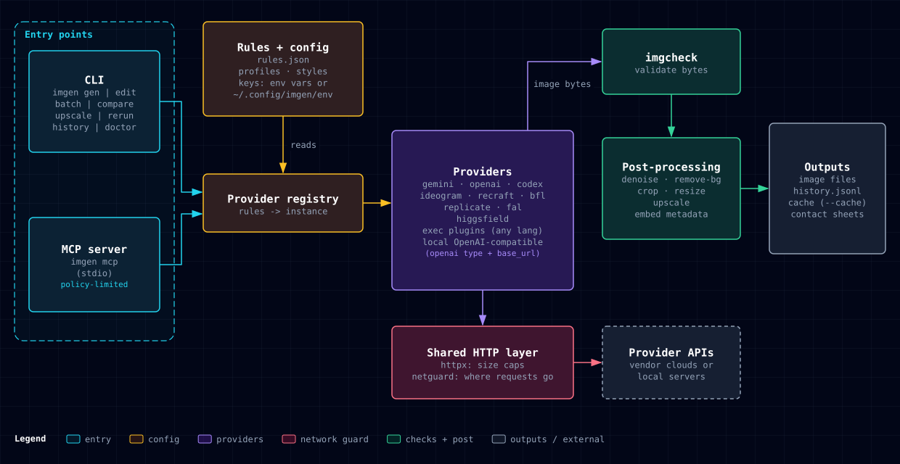

# Architecture

imgen is one Go binary with one external dependency (`golang.org/x/image`). A thin command layer parses flags into a provider-neutral request, a provider backend turns that request into one vendor's API call, and a shared post-processing and output layer validates, transforms and saves the images. The MCP server runs the same command code in-process, so there is one generation path. This page shows how the parts fit together and why they are built this way. It is for contributors and for users who want to know what happens to their prompt and keys.



## The life of one `imgen gen`


1. **Start-up.** `cmd/imgen` loads the key file (`envfile`) and the rules (`rules`: the embedded defaults plus your rules file).
2. **Flags.** `cli` parses flags, then applies a `--profile`. Flags you typed win over the profile.
3. **Prompt.** The prompt comes from the words, `-P file` or stdin. `--enhance` rewrites it with a text model; `--style` texts are appended; `--remove-bg` adds the green-screen instruction.
4. **Inputs.** Each `-i` and `--mask` (a path, a URL through `fetch`, or `clip:`) is size-capped and checked by `imgcheck` before any decoder sees it.
5. **Model.** `-m`, else the instance `default_model`. `-m latest` asks the provider for its model list and picks the newest one that the `deny` list allows.
6. **Budget and cache.** With `--cache`, a hit returns stored images. Otherwise `pricing` estimates the cost and `history` reserves it against `IMGEN_BUDGET` under a file lock.
7. **Provider call.** The backend builds the vendor request. HTTP goes through `httpx` (retries, size caps) on a client from `netguard` (address and credential rules). Codex and exec plugins run as child processes with a minimal environment from `subenv`.
8. **Validation.** Every returned image is checked by `imgcheck`: real type from the bytes, pixel limits, and an allowlist for SVG.
9. **Post-processing.** `post` runs denoise, then remove-bg, then crop, then resize.
10. **Save.** Files are created with `O_EXCL`, so nothing is overwritten; a clash adds `-1`, `-2`, .... `pngmeta` embeds the version, provider and model. `--meta` writes a 0600 sidecar. `--grid` writes a contact sheet with `sheet`.
11. **Record.** `history` appends one JSONL entry (secrets redacted), then the budget hold is released.
12. **Report.** Paths go to stdout; model, time and cost go to stderr; `--json` prints one result object.

## Package map

| Package | Role |
|---|---|
| `cmd/imgen` | Entry point. Loads keys and rules, blank-imports every provider, runs the CLI or the MCP server. |
| `internal/cli` | Every command: flags, profiles, styles, request building, budget, output contract, history, batch, compare, upscale, doctor, init, completion. |
| `internal/provider` | The `Provider` interface, `Config`, the type registry, model ID validation and the `timeout` option. |
| `internal/provider/gemini` | Gemini REST API. |
| `internal/provider/openai` | OpenAI Images API; also any OpenAI-compatible server through `base_url`. |
| `internal/provider/codex` | Images through `codex exec` and the user's ChatGPT login. |
| `internal/provider/ideogram` | Ideogram v3 API. |
| `internal/provider/recraft` | Recraft API, including SVG output. |
| `internal/provider/bfl` | Black Forest Labs FLUX API (submit, then poll). |
| `internal/provider/replicate` | Replicate predictions API. |
| `internal/provider/fal` | fal.ai queue API. |
| `internal/provider/higgsfield` | Higgsfield image API. |
| `internal/provider/exec` | Plugin backend: any command that speaks the JSON protocol. |
| `internal/rules` | Embedded default rules and the merge of the user rules file. |
| `internal/envfile` | Loads the private key file into imgen's own process. Fails closed on an insecure file. |
| `internal/netguard` | Builds every HTTP client. Blocks private, loopback and link-local addresses after DNS resolution and keeps keys on their API host. |
| `internal/httpx` | HTTP send with retry, backoff and response size caps. |
| `internal/fetch` | Resolves `-i` values: file, URL or clipboard. |
| `internal/imgcheck` | Validates untrusted image bytes before decoding, including the SVG allowlist. |
| `internal/imglimit` | Pixel, side and byte limits (`IMGEN_MAX_PIXELS`). |
| `internal/post` | Denoise, chroma-key background removal, crop and resize. |
| `internal/upscale` | Upscale through a provider model or locally. |
| `internal/sheet` | Labelled contact sheets for `--grid`, `batch --grid` and `compare`. |
| `internal/pngmeta` | Text metadata in PNG and JPEG files. |
| `internal/naming` | File names from prompts. |
| `internal/pricing` | Cost estimates from an embedded price table (`IMGEN_PRICES` overrides). |
| `internal/history` | Append-only JSONL history, spend totals and budget reservations. |
| `internal/cache` | On-disk result cache for `--cache`. |
| `internal/enhance` | Prompt rewriting with a Gemini or OpenAI text model. |
| `internal/preview` | Open, inline preview, clipboard copy and paste through the host desktop. |
| `internal/progress` | Terminal spinner and desktop notices. |
| `internal/subenv` | Minimal environment for child processes. |
| `internal/mcpserver` | MCP server over stdio: tool schemas, safety policy, workspace guard. |

The `contract/` module holds tests that check the requests imgen builds against each vendor's published OpenAPI spec. It is a separate Go module, so the main build stays at one dependency.

## Design choices

- **One binary, one dependency.** Everything except image codecs is the Go standard library. There are no vendor SDKs. A small surface is easy to build, audit and ship.
- **No model lists in the code.** Any model ID passes through to the API. `imgen models` and `-m latest` ask the API what exists now, so a new model works the day it ships.
- **Pass-through for everything else.** `--set key=value` goes straight into the request body, so new API options need no imgen release.
- **One code path.** `gen`, `edit`, `batch`, `compare`, `rerun` and the MCP tools all run the same `execute` function. The MCP server calls the CLI in-process with `--json`.
- **Providers are plugins.** A backend is a package that calls `provider.Register` in `init()`. Users add backends with no Go code through a `base_url` or an exec plugin. See [Extending](extending.md).
- **Never overwrite a file.** Files are created exclusively and get a numeric suffix on a clash.
- **A strict output contract.** Paths on stdout, information on stderr, one-line errors, stable exit codes and a `--json` shape that agents can parse.
- **Untrusted by default.** Provider responses, plugin output, input URLs and MCP tool arguments are all treated as untrusted and checked before use. See [Security](security.md).
- **Keys stay put.** Keys load from a private file into imgen's process only, go only to their own API host, and never reach child processes unless you allow it.
- **Tests run offline.** Providers are tested with `httptest` fake servers and fake processes, so `make test` needs no keys or network.

## Build and test

```sh
make build              # build the binary
make test               # go test -race ./...
make contract           # requests checked against vendor OpenAPI specs
make check              # the full gate: format, vet, lint, tests, vulns, secrets, SAST, CI audit
make install-skill      # link skills/imgen into ~/.claude/skills/imgen
```

`make check` also runs as a git pre-push hook and in CI. The tools it runs are listed in [Security](security.md#security-gate).
