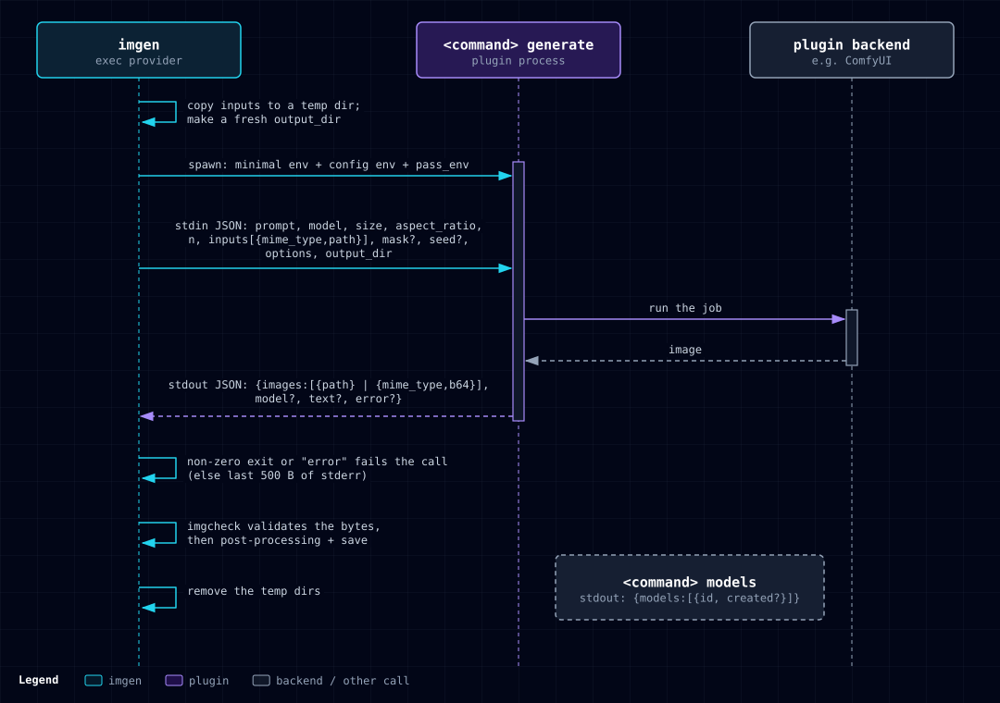

# Extending imgen

Add a new image backend to imgen. There are three ways. Pick the first one that fits.

| Way | Use it for | Code needed |
|---|---|---|
| Config-only OpenAI-compatible server | LocalAI, vLLM, any server with `/v1/images/generations` | none |
| Exec plugin | ComfyUI, Automatic1111, diffusers, another cloud, any language | one script |
| Native Go provider | A new HTTP API you want built into imgen | one Go package |

Related: [Configuration](configuration.md), [CLI reference](cli.md), [Providers](providers.md), [Security](security.md), [Troubleshooting](troubleshooting.md). For a full ComfyUI setup, see [Local models](local-models.md).

## Where backends are defined

A backend is a named instance in `~/.config/imgen/rules.json`, or in the file named by `$IMGEN_RULES`. That file merges over the built-in defaults. You pick an instance with `-p <name>`.

Instance fields:

| Field | Meaning |
|---|---|
| `type` | Required. A registered provider type, for example `openai` or `exec`. |
| `base_url` | HTTP backends. Replaces the default endpoint. |
| `api_key_env` | Name of the variable that holds the key. Empty uses the type's default variable (for example `IDEOGRAM_API_KEY`). The exceptions are an `openai` instance with a `base_url`, where empty means no key, and `exec` and `codex`, which have no key. |
| `command` | Exec only. The plugin argv. |
| `env` | Exec only. Extra environment variables for the plugin. |
| `default_model` | Model used when you pass no `-m`. |
| `deny` | Model ID globs to refuse. `*` is the only wildcard. |
| `options` | Free-form settings for the type. |

The rules file may also hold `styles`, `profiles`, `enhance` and `upscale`. See [Configuration](configuration.md). Each instance field you set replaces the built-in value. A `deny` list that is present replaces the old one, and `[]` clears it. Run `imgen providers` to check the result.

## A local OpenAI-compatible server (config only)

```json
{"providers": {"local": {"type": "openai", "base_url": "http://localhost:8080/v1", "default_model": "sdxl"}}}
```

```sh
imgen gen -p local -r 1024x1024 "a cat in a spacesuit"
imgen models -p local
```

Behavior with a `base_url`:

- No key is sent unless you set `api_key_env`. For a server that needs one, add `"api_key_env": "LOCAL_KEY"` and put `LOCAL_KEY` in `~/.config/imgen/env`.
- `imgen models` lists every model the server reports. It does not filter for image models. With the default OpenAI endpoint, it keeps only image models.
- imgen trusts the host you put in `base_url`. It allows plain HTTP and private addresses for that host only, and it sends the key only to that host.

## An exec plugin (any language)

An exec plugin is a command that imgen runs. imgen sends one JSON request on stdin. The plugin prints one JSON response on stdout.



Configure it:

```json
{
  "providers": {
    "comfy": {
      "type": "exec",
      "command": ["python3", "~/imgen-plugins/comfyui-plugin.py"],
      "env": {"COMFYUI_URL": "http://127.0.0.1:8188"},
      "options": {"workflow": "~/workflows/txt2img_api.json", "prompt_node": "6"}
    }
  }
}
```

- `command` is an argv list. A leading `~` in each argument becomes your home folder.
- imgen appends one subcommand to the argv: `generate` or `models`.
- `options` goes to the plugin as is. imgen reads only `timeout` and `pass_env` from it.

### The generate request

imgen runs `<command...> generate` and writes this JSON object to stdin:

```json
{
  "model": "",
  "prompt": "a red cube on a white table",
  "size": "",
  "aspect_ratio": "16:9",
  "quality": "",
  "format": "",
  "background": "",
  "n": 1,
  "extra": null,
  "options": {"workflow": "~/workflows/txt2img_api.json", "prompt_node": "6"},
  "inputs": [{"mime_type": "image/png", "path": "/tmp/imgen-in-123/input-0.png"}],
  "output_dir": "/tmp/imgen-out-456",
  "mask": {"mime_type": "image/png", "path": "/tmp/imgen-in-123/mask.png"},
  "seed": 42
}
```

| Field | Meaning |
|---|---|
| `model` | The `-m` value, or the instance `default_model`. May be empty. |
| `prompt` | The prompt text. |
| `size`, `aspect_ratio`, `quality`, `format`, `background` | The matching flags. An empty string means the user set nothing. |
| `n` | Number of images asked for. |
| `extra` | Raw extra parameters for the API. `null` if none. |
| `options` | The instance `options` object, unchanged. `null` if none. |
| `inputs` | Input images for an edit. Always a list, empty for plain generation. Each image is a file in a temp folder. |
| `output_dir` | An empty temp folder. The plugin may write result files here. |
| `mask` | Present only for a masked edit. White or transparent marks the area to change. The file is in the same temp folder as the inputs. |
| `seed` | Present only when the user asked for repeatable output. |

imgen removes the input folder and `output_dir` after it has read the results. Do not keep files there.

### The generate response

The plugin prints one JSON object to stdout:

```json
{
  "model": "optional model ID",
  "images": [
    {"path": "/tmp/imgen-out-456/a.png"},
    {"mime_type": "image/png", "b64": "iVBORw0KGgo..."}
  ],
  "text": "optional text",
  "error": "set only on failure"
}
```

| Field | Meaning |
|---|---|
| `images` | A list. Each item has either `path` or `b64`. |
| `path` | A file imgen reads. The MIME type comes from the file extension (`.png`, `.jpg`, `.jpeg`, `.webp`, `.gif`; other extensions use the system type table, else `application/octet-stream`). |
| `b64` | Standard base64 data. `mime_type` is optional and defaults to `image/png`. |
| `model` | Optional. The model ID the plugin used. |
| `text` | Optional text. A response with `text` and no images is accepted. |
| `error` | A message. If it is not empty, the call fails. |

### Errors

The call fails in these cases. They are checked in this order.

1. The response has a non-empty `error`. imgen reports `plugin error: <error>`.
2. The process exits non-zero. imgen reports `plugin failed:` and the last 500 bytes of stderr. If stderr is empty, it reports the process error.
3. Stdout is not valid JSON: `plugin returned invalid JSON`.
4. The response has no images and no text: `plugin returned no images`.
5. An image has neither `path` nor `b64`: `plugin image has neither path nor b64`.
6. A `path` cannot be read, or `b64` cannot be decoded.

Write a clear `error` message, and exit non-zero when you fail. Print progress and debug lines to stderr, never to stdout.

### The models subcommand

imgen runs `<command...> models` with no stdin. The plugin prints:

```json
{"models": [{"id": "echo-1", "created": 0}]}
```

`created` is optional (unix seconds). This feeds `imgen models -p <name>`. A non-zero exit gives `plugin models failed:` with the stderr tail.

### The environment a plugin gets

The plugin does not get your environment. It gets only:

- These variables, when they are set: `PATH`, `HOME`, `USER`, `LOGNAME`, `LANG`, `TZ`, `TERM`, `TMPDIR`, `TEMP`, `TMP`, `XDG_RUNTIME_DIR`, `XDG_CONFIG_HOME`, `XDG_CACHE_HOME`, `XDG_DATA_HOME`, `DISPLAY`, `WAYLAND_DISPLAY`, `DBUS_SESSION_BUS_ADDRESS`, `WSL_DISTRO_NAME`, `WSLENV`, `SYSTEMROOT`, `WINDIR`, and every `LC_*` variable.
- Every variable named in `options.pass_env`, if it is set in the parent.
- Every variable in the instance `env` map. These are added last.

API keys such as `OPENAI_API_KEY` or `GEMINI_API_KEY` reach a plugin only when you list them:

```json
"options": {"pass_env": ["HF_TOKEN"]}
```

Keys in `~/.config/imgen/env` are loaded by imgen and are not passed on unless named in `pass_env`. See [Security](security.md).

### Daily budget

imgen has no price for a plugin or a local server. When `IMGEN_BUDGET` is set, a call with an unknown price is refused with `over budget: the price of this call is unknown`. Add a price of 0 for the type with `IMGEN_PRICES` (see [Providers](providers.md#cost-notes)), or pass `--force`:

```json
{"models": [{"provider": "exec", "match": "*", "price": 0}]}
```

### Timeouts

- The default call deadline is 5 minutes. When it passes, imgen stops the plugin process.
- Set `options.timeout` for slow backends. It is a Go duration such as `"15m"`, or a number of seconds. It must be above zero and at most 24 hours.
- When you do not pass `--timeout`, the deadline becomes the longer of 5 minutes and `options.timeout` plus 30 seconds. An explicit `--timeout` always wins.
- Under `imgen mcp` the limit for each call stays at `IMGEN_MCP_TIMEOUT`.
- imgen does not pass `timeout` to your code in any special way. It is just part of `options`. If your plugin reads it, parse it the way you document it. The example ComfyUI plugin reads seconds only, so use a number there.

### Test a plugin without imgen

Pipe a request into the plugin and look at the output.

```sh
mkdir -p /tmp/out
echo '{"prompt":"a red cube","options":{},"inputs":[],"output_dir":"/tmp/out"}' \
  | python3 examples/echo-plugin.py generate
python3 examples/echo-plugin.py models
```

The first command prints `{"model": "echo-1", "images": [{"path": "/tmp/out/echo.png"}]}`. The second prints the model list.

Then try it through imgen. Put the `echo` instance from `examples/rules.json` in your rules file, and run:

```sh
imgen gen -p echo "test"
imgen models -p echo
imgen doctor
```

### Example files

- [`echo-plugin.py`](../examples/echo-plugin.py): writes a solid 64x64 PNG. Use it to test the protocol.
- [`comfyui/plugin.py`](../examples/comfyui/plugin.py): drives a ComfyUI server.
- [`comfyui/zimage_turbo_api.json`](../examples/comfyui/zimage_turbo_api.json): a ComfyUI workflow in API format.
- [`rules.json`](../examples/rules.json): sample instances for a local server and two plugins.

The `command` paths in `rules.json` assume you copied the plugins to `~/imgen-plugins/` (`comfyui/plugin.py` as `comfyui-plugin.py`). Change them if you put the files somewhere else.

## A native Go provider

Use this to build a new HTTP API into imgen.

1. Make the package `internal/provider/<name>/`.
2. Implement `provider.Provider`:

```go
type Provider interface {
	Name() string
	Generate(ctx context.Context, req provider.Request) (*provider.Result, error)
	ListModels(ctx context.Context) ([]provider.Model, error)
}
```

3. Register a factory from `init()`. The factory gets the instance `provider.Config` (`BaseURL`, `APIKeyEnv`, `DefaultModel`, `Options`, and so on):

```go
func init() { provider.Register("<type>", factory) }

func factory(cfg provider.Config) (provider.Provider, error) {
	// read cfg.BaseURL, and the key from os.Getenv(cfg.APIKeyEnv) or a default variable
	return &Client{ /* ... */}, nil
}
```

4. Send every HTTP call through `httpx.Send`. Use `httpx.PaidPolicy()` for every request that can bill (a generate, edit or submit): by itself it makes no retries. A paid request is retried after a 429 only on the provider's official API, up to `IMGEN_RETRIES` attempts in all; a try that the official API refused with a 429 costs nothing, so only the try that ran counts in the cost and the budget; a paid request to a custom endpoint is never sent twice. So set `Retry429` only when `httpx.OfficialHost(baseURL, defaultHost)` is true, set `Tally` to an `*httpx.Tally` (one per request; merge the tallies of several requests with `httpx.Combine`), and end `Generate` with `provider.Attempted(res, tally, err)`. Send it with `httpx.SendHint`, and append the hint that it returns to the status error. Use `httpx.DefaultPolicy()` for free API calls such as polls and model lists, and `httpx.ImagePolicy()` for downloads. These two make 3 attempts, or `IMGEN_RETRIES` attempts, and honor `Retry-After`.
5. When the backend cannot do something the user asked for, return a wrapped `provider.ErrUnsupported`. For example:

```go
return nil, fmt.Errorf("%w: mask", provider.ErrUnsupported)
```

6. Check model IDs with `provider.ValidModelID` before you put them in a URL path.
7. Add a blank import in `cmd/imgen/main.go`:

```go
_ "github.com/joshuafuller/imgen/internal/provider/<name>"
```

8. Add a default instance in `internal/rules/rules.json` so `imgen providers` lists it.
9. Write tests with `httptest` only. Tests must not call a real API.
10. Run the full gate before you commit:

```sh
make check
```

`internal/provider/openai` is a good model to copy. It handles a custom `base_url`, a key from the environment, and the network policy for private hosts.
