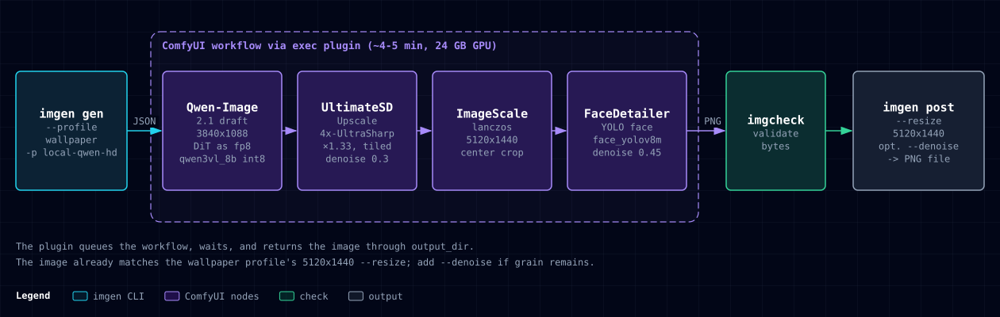

# Local models

Run imgen on your own GPU with ComfyUI and Qwen-Image-2.1. Images stay on your machine and cost nothing per call. imgen reaches ComfyUI through the `exec` plugin in `examples/comfyui/plugin.py`.

This page also points to the route for OpenAI-compatible local servers. See [Extending imgen](extending.md).

Related: [Configuration](configuration.md), [CLI reference](cli.md), [Providers](providers.md), [Security](security.md), [Troubleshooting](troubleshooting.md).

## What you need

- A running ComfyUI server. The plugin reaches it at `http://127.0.0.1:8188` unless you set `COMFYUI_URL`.
- A GPU with enough VRAM for the files below. imgen does not measure VRAM use.
- Python 3. The plugin uses only the standard library.
- These files in your ComfyUI model folders:

| Model | File in the ComfyUI folder | Size | Notes |
|---|---|---|---|
| `Comfy-Org/Qwen-Image-2.1` bf16 DiT | `diffusion_models/qwen_image_2.1_bf16.safetensors` | 14.2 GB | the diffusion model |
| `qwen3vl_8b` int8 text encoder | `text_encoders/qwen3vl_8b_int8_convrot.safetensors` | 9.4 GB | the text encoder |
| `madebyollin/texture-fix-vae-for-qwen-image-2.1` | `vae/texture_fix_vae_for_qwen_image_2.1_bf16.safetensors` | 0.7 GB | VAE with fixed fine textures |
| `4x-UltraSharp` | `upscale_models/4x-UltraSharp.pth` | 67 MB | upscaler for the detail pass |

File names and sizes are from the author's ComfyUI install. The download sources are the names in the first column.

## Load the model as fp8

The author's Qwen-Image-2.1 workflows set the weight dtype to `fp8_e4m3fn` on the diffusion model loader node. This lowers the VRAM the model needs. imgen has no measurement of the speed or quality effect.

## Export the workflow in API format

1. Build and test the workflow in the ComfyUI editor.
2. Choose "Save (API Format)". The normal "Save" gives a different file that the plugin cannot read.
3. Save the file, for example as `~/workflows/qwen-image-2.1-fp8_api.json`.
4. Open the file and note these node IDs. They are the top-level keys.
   - The text node that holds the prompt (`CLIPTextEncode`). You need its ID for `prompt_node`.
   - The sampler node that holds the seed (`KSampler`, or a noise node with `noise_seed`). You need its ID for `seed_node`.
   - The latent node that holds `width` and `height`. You need its ID for `size_nodes`.

The IDs `6`, `3` and `58` below are examples. Use the IDs from your own file. `examples/comfyui/zimage_turbo_api.json` is a small working API-format workflow you can open to see the shape.

## Install the plugin

Copy the plugin to a folder you control.

```sh
mkdir -p ~/imgen-plugins
cp examples/comfyui/plugin.py ~/imgen-plugins/comfyui-plugin.py
```

A plugin runs with your user rights. Read it before you use it. See [Security](security.md).

## Add a provider instance

Put this in `~/.config/imgen/rules.json`, or in the file named by `$IMGEN_RULES`. The file merges over the built-in providers.

```json
{
  "providers": {
    "local-qwen-hd": {
      "type": "exec",
      "command": ["python3", "~/imgen-plugins/comfyui-plugin.py"],
      "env": {"COMFYUI_URL": "http://127.0.0.1:8188"},
      "options": {
        "workflow": "~/workflows/qwen-image-2.1-fp8_api.json",
        "prompt_node": "6",
        "seed_node": "3",
        "size_nodes": ["58"],
        "timeout": 900
      }
    }
  }
}
```

imgen expands a leading `~` in each `command` argument. The plugin expands `~` in `workflow`.

The plugin reads these options:

| Option | Default | Meaning |
|---|---|---|
| `workflow` | none, required | Path to the API-format workflow file. |
| `prompt_node` | none, required | ID of the node that gets the prompt. |
| `prompt_field` | `text` | Input name on that node. |
| `seed_node` | none | ID of the node that gets the seed. The plugin sets `noise_seed` if the node has that input, else `seed`. It uses the `--seed` value, or a random number if you give none. Without this option the workflow keeps its own seed. |
| `size_nodes` | none | List of node IDs. The plugin sets `width` and `height` on each. |
| `megapixels` | `1.0` | Target area when you give only an aspect ratio. |
| `multiple` | `16` | Width and height are rounded to this multiple. |
| `max_edge` | `2560` | Cap for the long edge when you give only an aspect ratio. |
| `timeout` | `300` | Seconds the plugin waits for ComfyUI to finish. |

Size rules in the plugin:

- A `WxH` size (`-r 1344x768`) is used as is, rounded to `multiple`.
- Otherwise an aspect ratio (`-a 16:9`) is turned into a size from `megapixels`, capped by `max_edge`.
- With neither, the workflow keeps its own size.
- Size is set only on nodes listed in `size_nodes`.

The plugin reads `COMFYUI_URL` from its environment, so set it in the `env` map as above. It must start with `http://` or `https://`. The plugin exits with an error if it does not.

Check the result:

```sh
imgen providers
imgen models -p local-qwen-hd
```

`models` lists checkpoints, and UNET names if the loader nodes exist, from your ComfyUI server.

## Set the timeout

Local models can be slow, so give them time.

- `options.timeout` is read by two parts:
  - The plugin uses it as seconds. Use a number such as `900`. The plugin does not parse `"15m"`, and it fails on that value.
  - imgen accepts a number of seconds or a Go duration, and uses it for the call deadline.
- If you do not pass `--timeout`, the call deadline is the longer of 5 minutes and `options.timeout` plus 30 seconds. With `900`, that is 930 seconds.
- An explicit `--timeout` always wins:

```sh
imgen gen -p local-qwen-hd --timeout 20m "a misty pine valley at first light"
```

- Under `imgen mcp` the limit for each call stays at `IMGEN_MCP_TIMEOUT` (default 5 minutes). The provider `timeout` does not lift it.

When the deadline passes, imgen stops the plugin process. See [Troubleshooting](troubleshooting.md) if calls time out.

## Make a wallpaper

```sh
imgen gen --profile wallpaper -p local-qwen-hd "a misty pine valley at first light"
```

The built-in `wallpaper` profile sets:

- `--resize 5120x1440:fill`
- `-a 21:9` (cropped to 32:9 by the resize)
- the `clean-photo` style: "clean, noise-free, no film grain, smooth gradients, balanced exposure"

The provider is whatever you pass with `-p`. If a little grain remains, add `--denoise`. For all flags, see the [CLI reference](cli.md).

## HD detail pipeline

A plain upscale keeps the upscaler smear. This pipeline redraws real texture instead. Build it as one ComfyUI workflow, then point `workflow` at its API export.



1. Generate at the model's normal size.
2. Upscale with 4x-UltraSharp.
3. Run a second sampler pass at low denoise strength on the large image.
4. Let imgen do the final `--resize` and the optional `--denoise`.

The plugin saves every image that ComfyUI reports with type `output` (from `SaveImage` nodes). It skips other types, such as the `temp` images of preview nodes. Keep one `SaveImage` node at the end of the pipeline, or you get more than one image.

## Tips

- **VRAM.** If ComfyUI runs out of memory, use the fp8 DiT, or lower the size or the `megapixels` option.
- **Composition.** These are the author's observations, not tested by imgen. One large hero subject gives a sharper face than many tiny faces in a crowd.
- **Repeatable output.** Set `seed_node`, then pass `--seed`.

## OpenAI-compatible local servers

LocalAI, vLLM and similar servers need no plugin. Add an `openai` instance with a `base_url`. See [Extending imgen](extending.md#a-local-openai-compatible-server-config-only).
