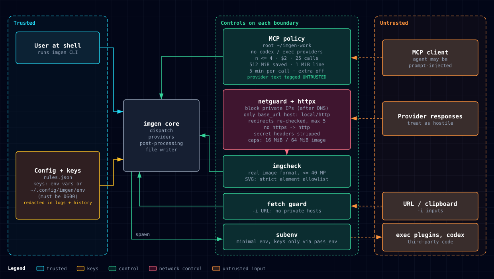

# Security model

imgen sends your prompts and images to image providers, and it writes what comes back to your disk. This page explains what imgen protects, what it trusts, and which settings change that. It is a summary for users. The policy and the reporting process are in [SECURITY.md](../SECURITY.md).



See also: [MCP server](mcp.md), [Configuration](configuration.md), [CLI reference](cli.md), [Extending](extending.md), [Architecture](architecture.md).

## Summary

- API keys come from a private key file that imgen reads itself. A key file that others can read stops imgen.
- Keys go only to the hosts of the provider they belong to. Redirects to other hosts lose the key.
- Outbound requests go to https only, and never to loopback, private or link-local addresses. The exceptions are a `base_url` that you configure yourself, and `-i` input URLs, which may use plain http (see [Input URLs](#input-urls)).
- Responses, downloads and images are size-capped. Every image is checked before a decoder sees it. SVG must pass a strict allowlist.
- Child processes (plugins, Codex, previews) get a minimal environment without your keys.
- Local files that hold prompts (history, sidecars, cache) are readable by you only.
- The MCP server confines paths, allowlists providers and caps spend, calls and disk use per session.

## Threat model

imgen assumes:

- **A single-user workstation.** imgen protects you from remote parties and from a confused or manipulated AI client. It does not protect you from other code that runs as your user.
- **Providers control every byte they return.** Response text, error messages, model names, URLs and image bytes are treated as hostile.
- **An MCP client may be prompt-injected.** A model that calls the MCP tools can send any valid arguments. It must not be able to read your files, write outside a workspace, run local programs, or spend without limit.

Your own config is trusted. A provider instance that you add to the rules file, its `base_url`, and an exec plugin that you install are trust decisions that you make.

## Key handling

- imgen reads keys from `~/.config/imgen/env`, or from the file named by `IMGEN_ENV_FILE`. The format is `KEY=VALUE` lines, with optional `export`, quotes and `#` comments.
- The file must not be readable by group or others. If it is, every imgen command, `imgen mcp` included, stops with an error and does not read the file. Fix it with:

  ```sh
  chmod 600 ~/.config/imgen/env
  ```

- A missing file is fine. A variable that is already set in your shell wins over the file.
- Keys stay in the imgen process. They go only to the hosts the provider is allowed to authenticate to (see below), and never to child processes unless you allow it (see [Child processes](#child-processes)).
- imgen removes key values from everything it stores or prints: the history, `--meta` sidecars, dry-run JSON and stored error text. It removes the values of the built-in key variables, of each provider's `api_key_env`, and of every variable whose name ends in `_KEY`, `_TOKEN` or `_SECRET` and whose value has 8 characters or more. Inside longer text, such as a prompt or an error, a value is removed only when it has 8 characters or more. A `--set` whose key looks like a credential (`key`, `token`, `secret`, `password`, `auth`, `cookie`, `credential`, `signature`) is dropped from stored arguments, and its value becomes `[redacted]` in sidecars and dry-run JSON. URLs lose their user info and query string.

## Network guard

Every HTTP client in imgen is built by one package with one policy.

- **https only.** Plain http is refused, except for a `base_url` host you configure and for `-i` input URLs.
- **Address check after DNS.** The connection is refused when the resolved address is loopback, private, link-local, multicast, unspecified, CGNAT (`100.64.0.0/10`), `192.0.0.0/24`, benchmarking (`198.18.0.0/15`), reserved (`240.0.0.0/4`) or unique local IPv6 (`fc00::/7`). IPv4 addresses inside IPv4-mapped and NAT64 (`64:ff9b::/96`) IPv6 addresses are checked too. Because the check runs on the dialled address, a DNS name that rebinds to a private address is still refused.
- **Proxy variables are ignored.** A proxy would hide the real destination from the address check.
- **Redirects.** At most 5. Each target is checked again. An https to http redirect is refused. When the target host may not receive credentials, the `Authorization`, `X-Goog-Api-Key`, `Api-Key`, `X-Key` and `Proxy-Authorization` headers are removed.
- **Credentials go only to allowed hosts.** Each provider lists the hosts that may receive its key.

### A custom base_url is a trust decision

When you set `base_url` for a provider (for example a local OpenAI-compatible server), imgen sends your key to that host and allows plain http and private addresses for that exact host only. Download, upload and poll URLs that the server returns on any other host still get the strict policy. Point `base_url` only at a server that you run or trust.

### Input URLs

`-i` accepts `http://` and `https://` URLs. They may use plain http, but they are refused at loopback, private and link-local addresses, so a URL cannot probe your local network. To fetch input images from your own network, set:

```sh
export IMGEN_ALLOW_PRIVATE_URLS=1
```

This opt-in applies only to input URLs. URL inputs are not available through the MCP server.

## Response and size caps

| Limit | Value |
|---|---|
| API response body | 16 MiB. 64 MiB for Gemini and OpenAI responses that carry base64 image data. |
| Image download body | 64 MiB |
| Input image or mask from disk | 64 MiB |
| Input image from a URL | 50 MiB, 30 second timeout |
| SVG document | 10 MiB |
| Width or height | 16384 pixels |
| Width x height | `IMGEN_MAX_PIXELS`, default 40,000,000 (8K UHD fits) |
| Retries | `IMGEN_RETRIES` attempts on 429, 500, 502, 503, 504 and network errors, default 3. `Retry-After` in seconds is honoured. A streamed OpenAI call is never retried, so a failure cannot cause a second paid request. |

For API responses and image downloads, a larger `Content-Length` is refused before the body is read. The pixel limit applies to inputs, masks, provider output, cache reads and post-processing.

## Output validation

Every image from a provider or from the cache is checked from its header before any full decode:

- It must be PNG, JPEG, GIF or WebP, and within the size limits above. An SVG must pass the rules below. The real format replaces the MIME type the provider claimed.
- Input images and masks get the same check, so a file that is not an image is never uploaded.

An SVG from a provider must be a passive image. imgen parses the whole document and refuses it unless:

- It has exactly one `<svg>` root in the SVG namespace, and every element is on an allowlist of structure, drawing, text, gradient, pattern, clip, mask, marker, image and filter elements. Script, `<style>`, `<foreignObject>`, links, animation, media and elements from other namespaces are refused.
- It has no DOCTYPE or other `<!...>` declaration, and no processing instruction other than the leading XML declaration.
- It has no event handler attribute (`on*`), no `src`, no `style` attribute, no `xml:base`, and no attribute from another vocabulary.
- Every `href` is a same-document `#fragment`. The only exception is a base64 PNG or JPEG `data:` URI on `<image>` or `<feImage>`. imgen decodes its header, refuses animated PNG, and checks it against the pixel limits.
- Attribute values call no function except `url(#fragment)`, colour functions and transforms, and contain no CSS escape, comment, `@import` or `expression(`.

## Child processes

Plugins, the Codex provider, previews and desktop notifications run with a minimal environment, not your full one. They get only these variables, when set:

- `PATH`, `HOME`, `USER`, `LOGNAME`, `LANG`, every `LC_*`, `TZ`, `TERM`
- `TMPDIR`, `TEMP`, `TMP`
- `XDG_RUNTIME_DIR`, `XDG_CONFIG_HOME`, `XDG_CACHE_HOME`, `XDG_DATA_HOME`
- `DISPLAY`, `WAYLAND_DISPLAY`, `DBUS_SESSION_BUS_ADDRESS`
- `WSL_DISTRO_NAME`, `WSLENV`, `SYSTEMROOT`, `WINDIR`

Your API keys are not on the list.

- **Exec plugins** also get the `env` map from their instance config, and each parent variable named in `options.pass_env`. List a key there only when the plugin needs it:

  ```json
  "options": {"pass_env": ["HF_TOKEN"]}
  ```

- **Codex** also gets `CODEX_HOME`. imgen runs `codex exec` with the `read-only` sandbox and `approval_policy="never"`, in a fresh temporary working folder that is deleted after the run.

See [Extending](extending.md) for plugin details.

## Local data

| Data | Location | Protection |
|---|---|---|
| History | `$XDG_STATE_HOME/imgen/history.jsonl`, else `~/.local/state/imgen/history.jsonl` | File mode 0600, folder 0700. Keys removed. |
| Budget ledger | `budget.jsonl` beside the history, used when `IMGEN_HISTORY=off` and `IMGEN_BUDGET` is set | Mode 0600. Cost only: no prompt, arguments, files or error text. |
| `--meta` sidecars | `<image>.json` next to each image | Mode 0600, created new (never overwrites). Keys removed. |
| Cache | `$XDG_CACHE_HOME/imgen`, else `~/.cache/imgen`. Used only with `--cache`. | Folder 0700, files 0600. |
| Generated images | Your output folder | Mode 0644, so others on the machine can read them. |
| Embedded metadata | Inside PNG and JPEG output | By default: imgen version, provider and model. `--embed-prompt` adds the prompt. `--no-embed` embeds nothing. |

The history and sidecars keep your prompts. To keep prompts out of both:

```sh
export IMGEN_HISTORY_PROMPTS=off
```

This also drops error text from the history, because a provider can echo the prompt in an error. To stop the history:

```sh
export IMGEN_HISTORY=off
```

With `IMGEN_BUDGET` set, imgen then keeps only the cost-only ledger.

Prompts leave your machine only to the image provider you chose and, with `--enhance`, to the enhance text provider you configured.

## MCP server

The MCP server treats its caller as untrusted. In short:

- All paths are confined to a workspace root (`IMGEN_MCP_ROOT`, default `~/imgen-work`). `/` and your home folder are refused as roots, and hidden folders are off limits.
- Input images must be real images inside the root, so a model cannot upload keys or config files.
- Providers of type `codex` and `exec` are off by default. `IMGEN_MCP_PROVIDERS` sets the allowlist.
- Provider-specific `extra` parameters are ignored unless `IMGEN_MCP_ALLOW_EXTRA=1`.
- Each session has a spend cap (default $2.00, unknown prices refused), a call cap (default 25), a disk cap (default 512 MiB) and a per-call deadline (default 5 minutes). The daily `IMGEN_BUDGET` still applies.
- Requests over 1 MiB and over-long fields are refused.
- Provider text comes back only in a separate item labelled `UNTRUSTED provider text`. Model listings carry only validated IDs as JSON.

The full policy, with every limit and override, is in [MCP server](mcp.md#safety-policy).

## Report a vulnerability

Do not open a public issue. Report it privately through GitHub Security Advisories, as described in [SECURITY.md](../SECURITY.md).

## Security gate

`make check` runs on your machine (pre-push hook). CI runs the tools in the table below as separate jobs on every push to `main`, on every pull request and weekly. Both fail on any finding.

```sh
make check
```

| Area | Tools |
|---|---|
| Format and static analysis | gofmt, go vet, golangci-lint (including gosec, staticcheck, errcheck, bodyclose, noctx, errorlint) |
| Tests | `go test -race`, contract tests |
| Dependencies | govulncheck, osv-scanner, trivy (vuln). Dependabot in CI. |
| Secrets | gitleaks (full history and working tree), trivy (secret) |
| SAST | semgrep (`p/golang`, `p/secrets`, `p/github-actions`) |
| Config and CI | trivy (misconfig), actionlint, zizmor |

## Review history

The v0.3 and v0.4 work had a series of independent read-only security reviews on 2026-10-14. Each pass checked the fixes for the previous one under the threat model above.

| Report | Outcome |
|---|---|
| [Pass 1](security/reviews/daybreak-2026-10-14-pass1.md) | 11 findings. Most urgent: MCP could launch Codex with attacker-controlled instructions, and authenticated URLs and child environments were not isolated. |
| [Pass 2](security/reviews/daybreak-2026-10-14-pass2.md) | Hardening confirmed. Not passed: `--enhance` network bypass, decoded-image size limits, model IDs in URL paths, MCP budget not mandatory. |
| [Pass 3](security/reviews/daybreak-2026-10-14-pass3.md) | 3 fixed, 8 partial. Not passed: provider text in trusted MCP output, input image bombs, active SVG, session disk use. |
| [Pass 4](security/reviews/daybreak-2026-10-14-pass4.md) | Not passed: trusted `list_models` output, a daily-budget bypass, SVG processing instructions, private-network access through custom providers. |
| [Pass 5](security/reviews/daybreak-2026-10-14-pass5.md) | Not passed: escaped-CSS SVG route, prompt leak in error text with prompts off, post-processing could pass the MCP disk cap. |
| [Pass 6](security/reviews/daybreak-2026-10-14-pass6.md) | All pass-5 findings closed. Not passed: SVG `xml:base` and external DTD references. |
| [Pass 7](security/reviews/daybreak-2026-10-14-pass7.md) | `xml:base` and DTD fixed. Not passed: foreign XML media elements in SVG. |
| [Pass 8](security/reviews/daybreak-2026-10-14-pass8.md) | Foreign media fixed. Not passed: SVG Tiny `<handler>` scripting and active SVG in `data:` URIs. |
| [Pass 9](security/reviews/daybreak-2026-10-14-pass9.md) | Scripting, data URI, animation and namespace issues fixed. Not passed: CSS image functions with quoted URLs. |
| [Pass 10](security/reviews/daybreak-2026-10-14-pass10.md) | **Pass** for the SVG boundary. Pass-9 blockers closed, no new bypass found. Scope was SVG validation only, and the verdict rests on source review, not a fresh test run. |
