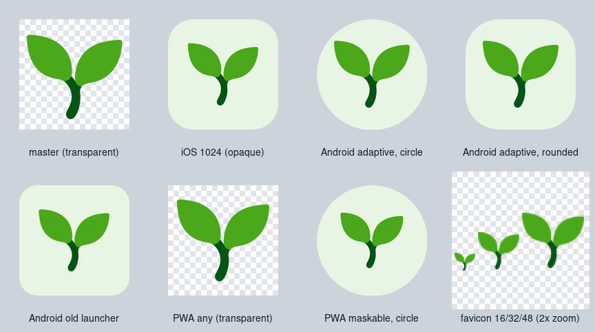
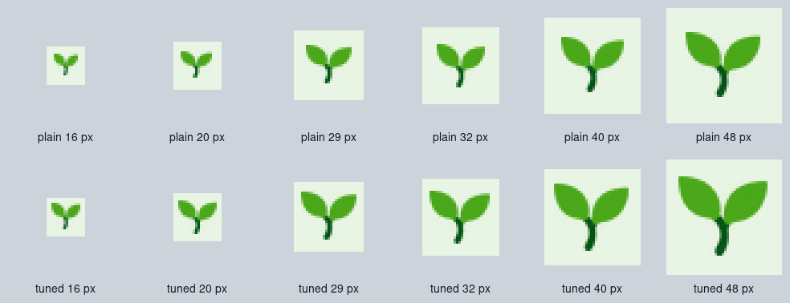

# App icons for every platform

Turn one prompt into a complete icon set for iOS, Android, the web and PWAs. imgen draws one transparent master icon. A free script then builds every size from it, with the padding, safe zones and file layout each platform expects. A model cannot draw dozens of icons that match, but it can draw one good one, and ImageMagick can size it exactly.



## Steps

1. Make the master with imgen, as a cutout (about $0.006):

   ```text
   imgen gen -p openai -q low -r 1024x1024 -b transparent -f png --name master \
     "flat vector app icon glyph: one bold seedling with two rounded leaves on a short curved stem, fresh green and deep green, thick smooth shapes with clean crisp edges, high contrast, perfectly centered and filling about 70% of the canvas, isolated on a fully transparent background, no ground, no soil, no pot, no shadow, no glow, no gradient, no outline, no text"
   ```

2. Build every size (free, and you can run it again at any time):

   ```text
   ./make_icons.sh master.png out/
   ```

3. Optional: pick the background color yourself. The default is a pale tint or a dark shade of the mark's own color. The script prints the one it chose.

   ```text
   ./make_icons.sh master.png out-cream/ --bg "#FFF8E7"
   ```

This folder holds the master from step 1 ([`master.png`](master.png)), so you can run step 2 now without an API key. [`sample/`](sample/) is its output.

## Outputs

| Path in `out/` | What |
|---|---|
| `ios/AppIcon.appiconset/` | One 1024 px icon and its `Contents.json` (Xcode 14 and later, "Single Size") |
| `ios/AppIcon-classic.appiconset/` | 15 PNGs and a `Contents.json` with all 18 iPhone and iPad entries (older Xcode, or "All Sizes") |
| `android/res/mipmap-*/ic_launcher.png` | The old launcher icon in 5 densities, 48 to 192 px, a rounded square |
| `android/res/mipmap-*/ic_launcher_foreground.png` | The adaptive icon foreground in 5 densities, 108 to 432 px, transparent |
| `android/res/mipmap-anydpi-v26/ic_launcher.xml` | The adaptive icon: a background color and the foreground |
| `android/res/values/ic_launcher_background.xml` | The background color |
| `web/favicon.ico` | Three frames: 16, 32 and 48 px |
| `web/icon-192.png`, `web/icon-512.png` | PWA icons, transparent (`purpose: any`) |
| `web/icon-maskable-192.png`, `web/icon-maskable-512.png` | PWA maskable icons: full-bleed background, the mark inside the safe circle |
| `web/manifest-icons.json` | The `icons` array, and the colors, to merge into your web manifest |
| `preview.png` | One sheet of the results (the picture above) |
| `legibility.png` | The small sizes at 3x zoom (see below) |

The script prints the background it chose and the result of its checks, for example `background #E9F5E4 (auto); the weakest color of the mark has contrast 2.7:1 against it` and `wrote 38 files to out/; 43 checks (size, alpha, JSON, XML) all passed`. It warns when that contrast drops below 1.8:1.

To use them: copy `ios/AppIcon.appiconset` into your `Assets.xcassets`; copy `android/res/*` into `app/src/main/res/` and set `android:icon="@mipmap/ic_launcher"` in the manifest; copy `web/*` to your site, link `favicon.ico`, and merge `manifest-icons.json` into your web manifest.

## What makes it work

- **One crop.** The script crops the master to the mark and centers it again, so every size has the same margins, even if the model drew the mark off center.
- **No alpha where it is forbidden.** The App Store rejects an icon that has an alpha channel. The iOS files and the maskable PWA icons are flattened onto the background, and the script checks that they have none.
- **Safe zones.** On Android the whole box of the mark fits in the 66 dp safe circle of the 108 dp layer, so a circle, a squircle or a teardrop mask never cuts it. In the maskable PWA icons the mark stays inside the 80 percent circle the web spec asks for.
- **Self-check.** At the end the script checks every pixel size, which files have alpha and which must not, the three favicon frames, that every file named in a `Contents.json` or the manifest exists at the size it claims, and the Android XML. It exits with 1 if one check fails.

## Small sizes

The favicon is 16 to 48 px, iOS uses icons of 20 to 58 px in notifications and settings, and the smallest Android launcher icon is 48 px. The script gives every size under 64 px less padding (the mark fills 78 percent instead of 64), so it stays readable. The top row is the plain downscale and the bottom row is what the script writes, at 3x zoom:



## Notes and limits

- Needs ImageMagick (`convert`, `identify`, `montage`), `awk` and bash. It was tested with ImageMagick 6.9.12, bash 5.2, and both GNU awk and mawk. `python3` is optional and only checks the JSON.
- The master needs a real transparent background and a bold, simple mark. OpenAI's `-b transparent` gives one. For another provider, `--remove-bg` keys out a green background, so it is a poor fit for a green mark like this one. Thin lines and fine detail turn to mush at 16 px. If the favicon looks muddy, draw a simpler master with `imgen edit` and run the script on it for the favicon.
- Not made: iOS 18 dark and tinted icons, macOS and watchOS icons, the Android monochrome layer for themed icons, and the Play Store listing icon.
- The script checks the files; they were not opened in Xcode or Android Studio.
- `master.png` is the real master, squeezed from 800 KB to 35 KB (stray near-transparent pixels removed, 16 colors). The sample was built from it with step 2, and running step 2 again gives the same files byte for byte.
