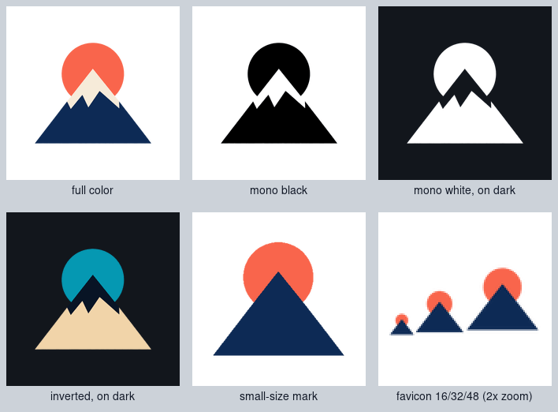
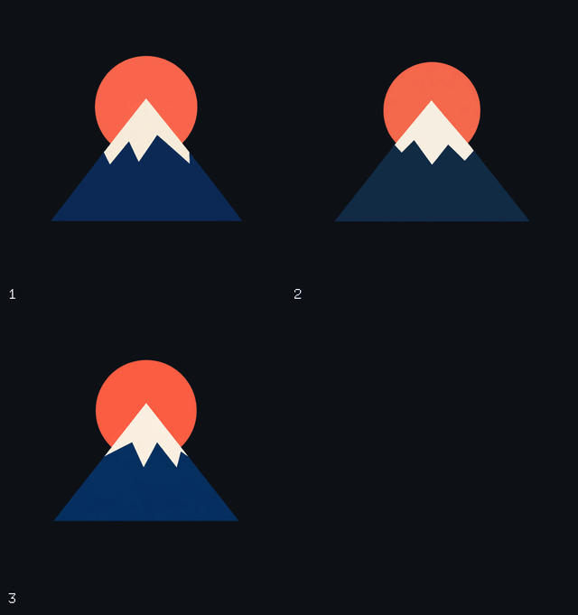
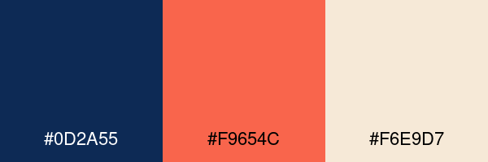

# A brand kit from one logo

Turn one logo into a small brand kit: full color, mono black, mono white, inverted, a small-size mark, a favicon, and a palette with hex codes. imgen draws the logo ideas, from a prompt or from your sketch. A free script then makes every version of the one you pick.



## Steps

1. Draw three ideas in one call (about $0.018). Ask for a mark only. Image models garble text, so set the brand name in a font later.

   ```text
   imgen gen -p openai -q low -r 1024x1024 -b transparent -f png -n 3 --grid --name logo \
     "minimal flat geometric logo mark for an outdoor gear brand: a bold triangular mountain with a cream snow cap and a round coral sun rising behind it, deep navy, coral and cream only, simple solid shapes, no gradients, no outlines, no shadow, centered with generous margin, isolated on a fully transparent background, a symbol only, no text, no letters"
   ```

   This saves `logo-1.png` to `logo-3.png` and the contact sheet `logo-grid.png`:

   

   To start from your own sketch, use `edit` with the same flags and the sketch as input (also about $0.018 for three):

   ```text
   imgen edit -p openai -q low -b transparent -f png -n 3 --grid --name logo -i sketch.png \
     "turn this sketch into a clean flat logo mark with bold simple shapes, no gradients, no outlines, isolated on a fully transparent background, no text"
   ```

2. Pick one. We keep number 1: it has the boldest colors.

   ```text
   cp logo-1.png logo.png
   ```

3. Build the kit (free, and you can run it again at any time):

   ```text
   ./make_kit.sh logo.png kit/
   ```

4. Optional: redraw the small-size mark yourself (about $0.006). Without this step the script makes one from the palette (see below), which is enough for this logo. Redraw it when the automatic one is not simple enough:

   ```text
   imgen edit -p openai -q low -b transparent -f png --name logo-small -i logo.png \
     "redraw this logo as the simplest possible version for a 16 pixel icon: one solid navy triangle for the mountain and one solid coral circle above it, no snow cap, no small details, same colors, isolated on a fully transparent background, no text"
   ./make_kit.sh logo.png kit/ --small logo-small.png
   ```

This folder holds the logo from step 2 ([`logo.png`](logo.png)), so you can run step 3 now without an API key. [`sample/`](sample/) is its output.

## Outputs

| File in `kit/` | What | Use on |
|---|---|---|
| `logo-color.png` | Full color, cropped and centered on a square transparent canvas | light backgrounds |
| `logo-mono-black.png` | One color, black | light backgrounds, one-color print |
| `logo-mono-white.png` | One color, white | dark backgrounds |
| `logo-inverted.png` | Every color flipped (navy becomes sand, coral becomes teal) | a quick dark-mode check |
| `logo-small.png` | The small-size mark, 256 px | anything under 64 px |
| `favicon.ico` | Three frames: 16, 32 and 48 px, cut from the small-size mark | `<link rel="icon" href="/favicon.ico">` |
| `palette.png` | The colors as swatches with their hex codes | |
| `palette.md` | The same colors as a table: hex, RGB, share, and the text color to put on it | |
| `variants.png` | One sheet with every version (the picture above) | |

The script prints the palette it found and the result of its checks, for example `palette (3): #0D2A55 #F9654C #F6E9D7` and `wrote 9 files to kit/; 16 checks (size, transparency, mono, favicon, palette) all passed`.

## Palette

The script finds the solid colors of the logo with ImageMagick (`-colors`, then a histogram), biggest area first, and keeps at most 5. This logo has 3 flat colors, so the table has 3 rows:



| # | Hex | RGB | Share | Text on it |
|---|---|---|---|---|
| 1 | `#0D2A55` | 13, 42, 85 | 54% | white (14.2:1) |
| 2 | `#F9654C` | 249, 101, 76 | 33% | black (7.0:1) |
| 3 | `#F6E9D7` | 246, 233, 215 | 12% | black (17.6:1) |

## What makes it work

- **Mono keeps shapes apart.** Every dark pixel becomes one ink color, but light parts (the cream snow cap) are left out, like white paper. The sun and the mountain stay two shapes. A plain silhouette would merge them into a keyhole; `--paper 100` shows it.
- **The small mark is made from the palette.** Only the 2 biggest colors stay. Smaller details, here the snow cap, join the darker of the two, so the mountain becomes one clean triangle in front of the sun. The edges are hard and the margin is small, so it holds up at 16 px. The favicon is cut from it, and its colors are exactly the palette's.
- **The palette ignores edges.** Anti-aliased pixels at the border of a shape are blends, not brand colors, so only solid pixels count. Specks under 0.5 percent are dropped.
- **Self-check.** At the end the script checks the sizes, that every logo file has real transparency, that the mono files hold one color, the three favicon frames, and that each swatch of `palette.png` has the hex code of its row in `palette.md`. It exits with 1 if one check fails.

## Notes and limits

- Needs ImageMagick (`convert`, `identify`, `montage`), `awk` and bash. It was tested with ImageMagick 6.9.12, bash 5.2, and both GNU awk and mawk.
- The logo needs a real transparent background. OpenAI's `-b transparent` gives one. For another provider, `--remove-bg` keys out a green background, so it is a poor fit for a green logo.
- Mono is decided by lightness: pixels lighter than 85 percent are left out. If an important part of your logo is light, raise the level with `--paper 95`, so only near-white is left out. `--paper 100` keeps the whole shape as a silhouette.
- Inverted is a plain color negative. It is a quick check, not a designed dark-mode logo.
- The kit is raster only: PNG and ICO, no SVG.
- `logo.png` is idea number 1, squeezed from 750 KB to 21 KB (stray near-transparent pixels removed, 8 colors). The sample was built from it with step 3, and running step 3 again gives the same files byte for byte.
