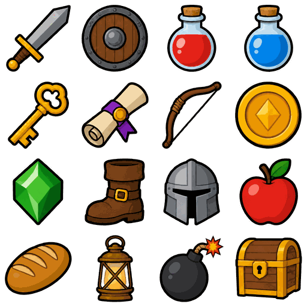
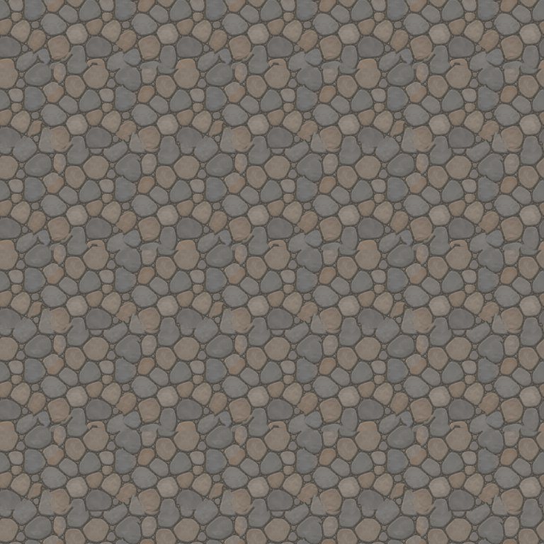
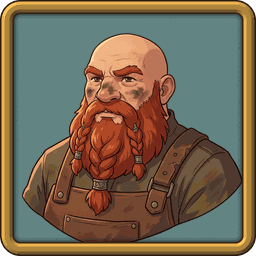
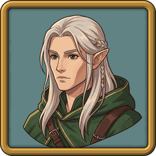

# Make a game asset kit

Make the small assets a 2D game needs: a sheet of item icons, a texture tile that repeats without a seam, and portraits for dialogue boxes. The model draws the pictures. Short scripts do what a model cannot do exactly: cut the grid, center each icon, hide the seam, draw the frame. They also check the result with numbers, so you do not have to trust your eyes alone.

| Icons and atlas | Tile, repeated 3x3 |
|---|---|
|  |  |

 

For character animation (a walk, an idle, an attack), see [../sprite/](../sprite/).

## Steps

From this folder, make a work folder and run all commands in it. The scripts run with `uv`, and each one explains its options in its first lines.

```text
mkdir work && cd work
```

**Item icons.** One call draws all 16 icons on one sheet (about $0.006). Keep the words "floating on a fully transparent background, no cell backgrounds, no borders, even spacing, no text" as they are.

```text
imgen gen -p openai -q low -r 1024x1024 -b transparent -f png -o raw --name items-sheet \
  "a 4x4 grid of 16 flat game item icons, flat vector style, bold dark outlines, bold flat colors, one icon per grid cell. Row 1: iron sword, round wooden shield, red health potion, blue mana potion. Row 2: golden key, rolled magic scroll, wooden bow, gold coin. Row 3: green gem, leather boot, steel helmet, red apple. Row 4: loaf of bread, brass lantern, round black bomb, wooden treasure chest. All 16 icons floating on a fully transparent background, no cell backgrounds, no borders, even spacing, no text, no drop shadows"
```

Look at the sheet. The model can change the order of the icons, so write the names in the order you see, row by row. Then cut the sheet into icons and an atlas (free):

```text
uv run --with pillow --with numpy --with scipy python -I ../icons.py raw/items-sheet.png out \
  --names sword,shield,potion-red,potion-blue,key,scroll,bow,coin,gem,boot,helmet,apple,bread,lantern,bomb,chest \
  --colors 256
```

**Tile.** Ask for a seamless texture with flat light (about $0.006), then measure the seam and fix it (free):

```text
imgen gen -p openai -q low -r 1024x1024 -f png -o raw --name cobble \
  "seamless tileable game texture, flat top-down orthographic view of a cobblestone path, irregular gray and tan stones with dark gaps between them, flat even lighting, no shadows, no vignette, nothing that stands out, hand-painted stylized look, no text"
```

```text
uv run --with pillow --with numpy python -I ../tile.py raw/cobble.png out --size 256
```

The script measures the model's raw tile first. Here it found a seam on both axes, then reported the fixed 256 px tile:

```text
raw   1024x1024  left-right wrap pair   5.2 vs typical   2.9 (x1.81, above 99.8% of pairs); middle x1.04  -> seam found
raw   1024x1024  top-bottom wrap pair   5.3 vs typical   2.9 (x1.84, above 100.0% of pairs); middle x0.93  -> seam found
tile  256x256  left-right wrap pair   3.2 vs typical   5.2 (x0.61, above 13.4% of pairs); middle x0.67  -> wraps
tile  256x256  top-bottom wrap pair   5.5 vs typical   5.4 (x1.03, above 56.7% of pairs); middle x1.03  -> wraps
```

**Portraits.** Draw the first portrait (about $0.067). Draw the second with the first as `-i`, put the same style block in both prompts word for word, and say what must be different:

```text
STYLE="Bust portrait for a game dialogue box: head and shoulders, facing slightly left, centered with a margin around the head. Soft painted flat-shaded style, clean dark outlines, limited warm palette, soft light from the upper left, plain muted teal background. No frame, no border, no text."
imgen gen -p gemini -m gemini-3.1-flash-image -r 1K -a 1:1 -o raw --name portrait-dwarf \
  "A stocky older dwarf blacksmith with a bald head, a bushy braided red beard, soot on his cheeks and a brown leather apron. $STYLE"
imgen gen -p gemini -m gemini-3.1-flash-image -r 1K -a 1:1 -i raw/portrait-dwarf.jpg -o raw --name portrait-elf \
  "Match the art style, line weight, shading, lighting, framing and background of the reference image exactly, but draw a different character with a different face, age, build, hair and clothes. A slender young elf ranger with long silver hair, sharp cheekbones, calm green eyes and a deep green hooded cloak with gold trim. $STYLE"
```

Make them square, 256x256, and draw one frame over both (free). The `gemini` provider returns JPEG whatever `-f` says, so the raw files end in `.jpg`.

```text
uv run --with pillow --with numpy python -I ../portraits.py out/portraits raw/portrait-dwarf.jpg raw/portrait-elf.jpg --colors 256
```

**Check everything** (free). It prints one PASS or FAIL line for each check and ends with `all checks passed: 0 failing`:

```text
uv run --with pillow --with numpy python -I ../verify.py out --sheet raw/items-sheet.png
```

## Outputs

| File | What |
|---|---|
| `icons/item_NAME.png` | One icon: 128x128, transparent, trimmed, centered, 8 px clear all around |
| `items-atlas.png` | All 16 icons in a 4x4 grid, 512x512 |
| `items-atlas.json` | TexturePacker-style frame data (hash format) that game engines read |
| `tile.png` | The tile, 256x256, wraps left-right and top-bottom |
| `tile-3x3.jpg` | The tile repeated 3x3, to look at the joints |
| `portraits/NAME.png` | A portrait, 256x256 |
| `portraits/NAME-framed.png` | The same portrait with the frame; the corners are transparent |
| `portraits/frame.png` | The frame alone, with a clear window, to lay over any portrait |

The [`sample/`](sample/) folder holds the real result of these steps. It is small on purpose: the sample uses `--colors 256` and a 256 px tile, and it does not keep the raw images. From this folder, `uv run --with pillow --with numpy python -I verify.py sample` checks it too.

## What makes it work

- **Clean alpha first.** In the sample sheet the solid parts of the icons are at alpha 253, not 255, and a faint haze (alpha 1 to 16) surrounds every icon. The script stretches alpha: 16 and below becomes 0, 240 and above becomes 255. Without this step the haze makes each trim box 5 to 16 px too big, so the icons come out smaller and off center.
- **The grid comes from the sheet.** The script reads the clear gaps between rows, then between the columns inside each row, and cuts through the middle of each gap. It does not use fixed offsets: in the sample the row cuts fall at y=263, 513 and 752, not at 256, 512 and 768, and every icon still comes out whole. If an icon crosses a grid line or touches the edge of its cell, the script stops and says which one.
- **No halo.** Each icon is scaled as a whole, with its color weighted by alpha, to fit 112 px, and centered on a 128 px canvas.
- **One set of pixels.** The atlas is made first and the icons are cut out of it, so `verify.py` can prove that every frame equals its icon file, pixel for pixel.
- **A seam is a number.** For every pair of neighbor columns (and rows) the check takes the mean pixel difference. The pair across the wrap is a seam if it is more than 25% above the typical pair and bigger than 98% of all pairs. It tests the wrap pair and the middle pair, because a plain roll by half leaves its old seam in the middle.
- **The fix cuts, it does not cross-fade.** The script rolls the tile by half its size, so the old edges are in the middle and the old middle wraps cleanly at the edges. It then puts the middle strip of the original back over the old edges. Each strip border follows the cheapest path, where the two copies already agree, and is feathered by a few pixels. A cross-fade of two stone layouts leaves ghost stones; a cut keeps the stones sharp.
- **Fix first, shrink second.** The tile is fixed at full size, where a seam can be measured. The shrink then reads across the edges, so the small tile stays exactly periodic: shrinking a rolled tile gives exactly the rolled small tile. A normal resize treats the edge as the end of the picture and moves the edge pixels by up to 5 levels on this tile (12 on the grass tile).
- **One frame for all.** The frame is drawn once in code (a bevel lit from the upper left, dark outlines, a soft shadow on the art) and laid over every portrait, so the set looks like one set. It covers the outer 14 px of the art, so ask the model for a margin around the head.
- **One style for all.** The second portrait is drawn with the first as a reference, and its prompt repeats the style block word for word and says what must change (face, age, build, hair, clothes). For more portraits, pass the first one as `-i` every time, not the last one, so the style does not drift.

## Notes

- **Cost.** These steps cost about $0.15: $0.006 for the sheet, $0.006 for the tile and $0.067 for each portrait. All the scripts are free and you can run them again on the same raw images at any time. `--dry-run` shows the cost of each `imgen` call first.
- **Palette PNGs.** `--colors 256` saves 8-bit palette PNGs with soft edges kept. The 16 icons shrink from 251 KB to 58 KB and the atlas from 255 KB to 43 KB, and flat-style art looks the same. Leave it out for full-color files.
- **The atlas** is a plain 4x4 grid with `"trimmed": false`, in the same hash format as the [sprite](../sprite/) example. A real packer can trim and pack tighter, but the grid is simple and fine for 16 UI icons.
- **Other textures.** The same steps also made a seamless grass tile with `-p gemini -r 1K`. Its raw tile had a seam at 1024 px (left-right x1.44, top-bottom x1.90) and wrapped after the fix.

## Limits

- **The grid can break.** A model can draw 15 icons, let two icons touch, or let one run over the edge. `icons.py` stops with a message. Draw the sheet again (about $0.006). The script cannot tell whether an icon looks good, so look at `items-atlas.png`.
- **Transparent sheets need the `openai` provider.** `-b transparent` gives real alpha with `-p openai`. For other providers use `--remove-bg` (see the [recipes](../../docs/recipes.md)) and check the edges for a green fringe.
- **A cut can chop a stone.** On stones, the cut sometimes ends a stone early or joins two. In `sample/tile.png`, look at the stone about 130 px from the left and 90 px from the top: its outline has a notch where two stones were joined. Stone and grass were tested; water, sand and regular patterns (brick, planks, a tile grid) were not. One big stone repeats as a visible pattern in the 3x3.
- **The seam number is not an eye.** At a small size, pixel noise hides a mild seam from the check: the raw grass tile from the Notes passes the check when it is only shrunk to 256 px, although its seam is measurable at 1024 px. Measure at full size, and always look at the 3x3.
- **Style is checked loosely.** `verify.py` only compares the background color, the weight of the dark outlines and the color strength of the portraits. The elf is a little less colorful than the dwarf (saturation 0.29 against 0.39). Look at them side by side.
- **The sample is a sample.** It is small (256 px tile, 256 colors). For real work use `--size 512` or more and full color.
