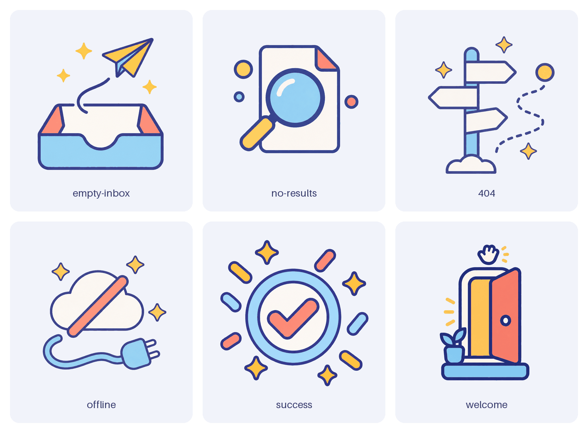
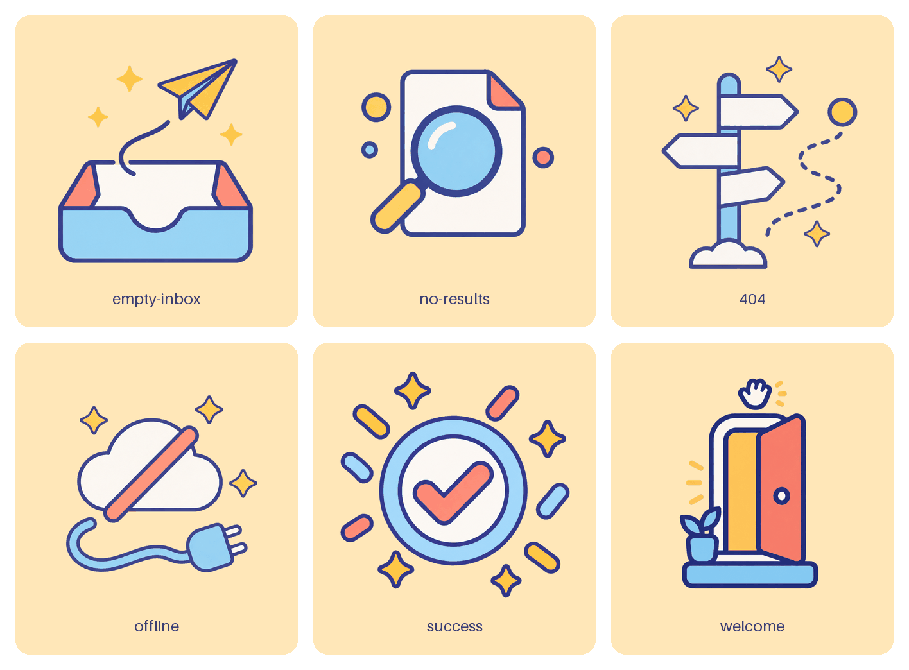

# A consistent illustration pack for an app

Make six app illustrations that look like one set: an empty inbox, no results, a 404 page, offline, success and a welcome screen. Image models do not keep a style from one prompt to the next. So imgen draws the first image alone, and then gives that image to every other prompt as a style reference (`-i`), together with one shared `--style`. A batch file lists the six subjects. The images are transparent PNGs, and a free script checks them and draws the contact sheet.



## Steps

You need `imgen` with an OpenAI key (`imgen init`) and `uv`. Without `uv`, Python with Pillow and numpy also works.

1. Check the cost first. This calls no API and writes no image:

   ```text
   DRY_RUN=1 ./make_pack.sh out
   ```

2. Make the pack. It is one draw and five edits. Before each call imgen holds its top price: about $0.008 for the draw and $0.064 for each edit (about $0.33 for the pack). The real cost is lower: about $0.05 to $0.10 for the pack (see the notes). It takes about 25 seconds:

   ```text
   ./make_pack.sh out
   ```

   The script prints the saved paths and then the checks. This is the sample run:

   ```text
   == 1/2 style anchor: empty-inbox
   == 2/2 the other images, with the anchor as the style reference
   == tidy, check, contact sheet
   image        size         clear  margin  palette   line  result
   empty-inbox  1024x1024   84.6%   21.9%     0.99  1.00x  PASS
   no-results   1024x1024   84.3%   23.4%     0.99  1.17x  PASS
   404          1024x1024   91.0%   21.2%     0.97  0.83x  PASS
   offline      1024x1024   85.9%   20.0%     0.99  1.58x  PASS (warn: line)
   success      1024x1024   82.9%   18.1%     0.98  1.00x  PASS
   welcome      1024x1024   86.0%   19.9%     0.98  1.08x  PASS
   ALL CHECKS PASSED
   style warnings: offline. Delete those PNGs and run make_pack.sh again to draw them again.
   ```

3. Look at `out/contact-sheet.png`. If one image is off, delete it and run step 2 again. The script draws only the missing image, with the same anchor and the same styles. This is the same sample, after `rm out/offline.png`:

   ```text
   offline      1024x1024   88.7%   23.1%     0.98  0.75x  PASS
   ALL CHECKS PASSED
   ```

   That run was one call. The `offline` line is now within the limit (0.67x to 1.5x), so the sheet above shows the second drawing.

4. Optional: also write copies on an exact brand color. The script keeps the six images it has and adds only the copies and a second sheet (free):

   ```text
   BRAND_BG="#FFE7B8" ./make_pack.sh out
   ```

   

## What the script runs

```text
export IMGEN_RULES=rules.json
sed -n 1p jobs.jsonl | imgen batch -p openai -q low -r 1024x1024 -b transparent -f png --style pack -o out -
sed 1d jobs.jsonl | imgen batch -j 5 -p openai -q low -r 1024x1024 -b transparent -f png \
  --style pack --style pack-ref -i out/empty-inbox.png -o out -
```

The first call draws line 1 of `jobs.jsonl`, the anchor. The second call draws lines 2 to 6, five at a time, and every job gets the anchor as `-i`. `-` makes `imgen batch` read the jobs from the pipe. The script skips comment lines, adds `--no-preview`, and skips any job whose image is already in `out/`.

## Outputs

| File | What |
|---|---|
| `out/NAME.png` | The six illustrations: 1024x1024, transparent PNG, 140 to 270 KB each |
| `out/contact-sheet.png` | The six on a light panel, with their names. [Here](contact-sheet.png). |
| `out/brand/NAME.png` | With `BRAND_BG` only: the same six on that color, no alpha |
| `out/contact-sheet-brand.png` | With `BRAND_BG` only. [Here](contact-sheet-brand.png). |

The full-size images are not in this repository, only the two sheets (shrunk to 128 colors, about 170 KB each). The six names are the `name` fields in [`jobs.jsonl`](jobs.jsonl).

## What makes it work

- **One anchor, shared by all.** The first image sets the palette, the line weight and the shapes. Every later prompt gets it as `-i`, so the model copies a look it can see, not a look it must imagine.
- **Two named styles.** [`rules.json`](rules.json) holds `pack` (the look: flat vector, even dark outline, four colors, no text) and `pack-ref` (the order to match the reference and not to copy its subject or layout). `--style` adds each one to the prompt. The anchor gets `pack` only. The other five get both.
- **The batch file holds subjects only.** `jobs.jsonl` has a name and a subject per line. To make a new pack, change those lines and keep the styles.
- **Alpha from the API, then tidied.** `-b transparent` makes a true alpha channel. The model leaves a faint haze (alpha 1 or 2) around the art and no fully solid pixel (alpha 253). `finish_pack.py` cuts the haze and makes the art solid. The haze is invisible on a light page, but it shows on dark pages and in viewers that ignore alpha. It also makes each file much smaller (about 700 to 860 KB before, 140 to 270 KB after).
- **Checks that can fail.** Size, real transparency and a margin around the art must pass, or the script exits with 1. The palette and the line weight only warn, because they measure style, and style is a matter of taste:
  - `palette` is the share of solid pixels close to a color the anchor uses (0.85 or more is fine). In a test on one image, a hue shift of 30 degrees scored 0.76 and a shift of 60 degrees scored 0.06.
  - `line` is the outline thickness compared with the anchor's (0.67x to 1.5x is fine).
- **A brand color that is exact.** The copies in `brand/` are made in code from the transparent images, so the background is exactly the color you gave. The script reads the four corners of each copy to prove it. The model is never asked for the color.

## Notes and limits

- **Style drift is small, not zero.** In the sample run the palette matched at 0.97 to 0.99 (in one earlier run, one image scored 0.78 because its light was a paler yellow). The outline weight moved between 0.75x and 1.6x of the anchor's, and the size of the subject moves too. The redrawn `offline` image is a little smaller than the other five. Look at the sheet; do not trust the numbers alone.
- **The first version of one prompt drifted badly.** It asked for a document with a dotted outline, and the lines came out 1.75x and 2.0x as heavy as the anchor's in two runs of two. A blank sheet of paper, and the words "outline thickness" and "about the same size as the reference subject" in `pack-ref`, brought every image to between 0.75x and 1.6x. Dotted lines and large subjects push the model to draw heavier lines.
- **A new run is a new look.** The anchor is drawn again on every fresh run, so its colors change (one run had a coral tray, another a blue tray). Each pack is consistent inside itself. To keep a look, copy its anchor into a new folder first (`mkdir out2; cp out/empty-inbox.png out2/`). The script then draws only the other five.
- **The anchor decides everything.** If it is poor, every image copies the fault. Run step 2, look at `empty-inbox.png`, and delete the folder if you do not like it.
- **OpenAI only.** The script asks OpenAI for transparency, because Gemini cannot make an alpha channel. The checks fail on an image with no transparent pixels.
- **Low quality is enough here.** The sample is `-q low`. For `QUALITY=medium ./make_pack.sh out`, `imgen --dry-run` holds about $0.055 for the draw and $0.11 for each edit, about $0.61 for the pack. That run was not made for this example.
- **imgen holds more than a call costs.** OpenAI publishes no rule for the tokens of an input image on this model, so before an edit imgen holds room for 6,821 tokens per input image, the most that OpenAI's published input rule allows. After the call, imgen books the tokens that OpenAI reports. One measured edit of this pack (`-q low`, 1024 px, the anchor as input) used 1,060 input tokens and 196 output tokens: about $0.014. For the pack, expect about $0.05 to $0.10. `imgen history --cost` shows what each call cost.
- **Your rules file is not read.** The script sets `IMGEN_RULES` to the `rules.json` in this folder. To use the two styles in your own setup, copy the `styles` block into `~/.config/imgen/rules.json` and remove the `export` line from the script.
- **No words in the pictures.** The 404 sign is blank on purpose. Image models garble letters, so draw "404" and the other texts in your app.
- **Dark pages.** The outlines are dark indigo and vanish on a dark background. Put the art on a light card, or use the `brand/` copies.
