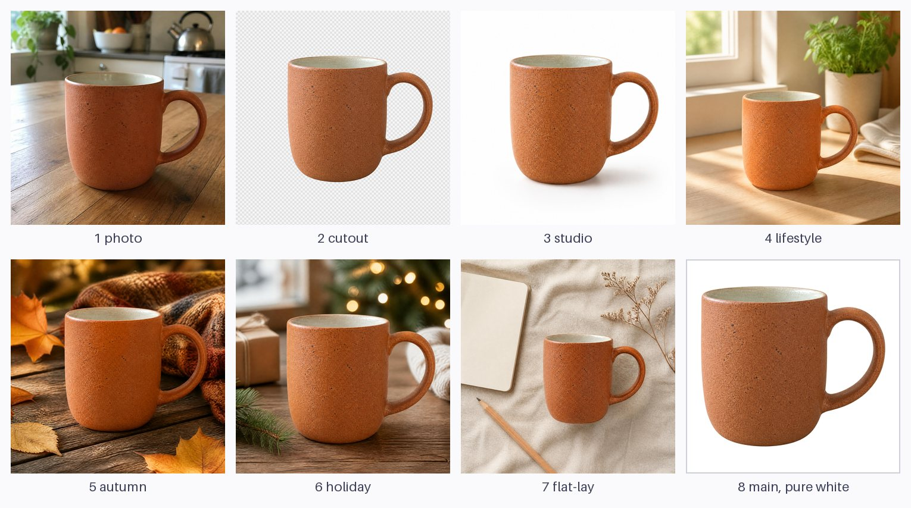

# One product photo, a full listing

One phone photo of a product goes in. imgen takes the background off and puts the product into five new scenes. A free script then exports what a shop listing needs: a 2000x2000 main image on pure white, 1600x1600 listing images and 1080x1080 social squares. The sample product is a plain, unbranded ceramic mug that imgen drew, so no real product or brand is in the pictures.



The board shows the photo, the cutout (on a checkerboard), the five scenes, and the main image on pure white. `overview.jpg` is one of the outputs.

## Steps

You need `imgen` with an OpenAI key (`imgen init`) and `uv`. Without `uv`, Python with Pillow and numpy also works. The sample photo is [`sample/mug-photo.jpg`](sample/mug-photo.jpg).

1. Check the cost first. This calls no API and writes no image:

   ```text
   DRY_RUN=1 ./make_listing.sh sample/mug-photo.jpg out
   ```

2. Make the set. It is one cutout and five scenes: six calls. imgen estimates about $0.04 in all, but the real cost is higher (see the notes: expect about $0.10 to $0.20). The calls run one after another, so it takes about 100 seconds:

   ```text
   ./make_listing.sh sample/mug-photo.jpg out
   ```

   The script checks the cutout before it makes the scenes, and checks every export at the end. This is the sample run (imgen also prints the model, the time, the cost and the saved path of each image, left out here):

   ```text
   == 1. cutout (the background comes off)
   PASS out/cutout.png: RGBA, corners clear, 72% transparent, margin 8.1%, strongly green 0.00% of the solid pixels
   == 2. scenes (the cutout goes into each one)
   == 3. exports and checks
   file                                   size        result  check
   cutout.png                             2048x2048   PASS    RGBA, corners clear, 72% transparent, margin 8.1%, strongly green 0.00% of the solid pixels
   exports/main-2000x2000.png             2000x2000   PASS    outer 8px all #FFFFFF, product spans 86%, 54% of the frame is #FFFFFF
   exports/listing-1600/01-main.jpg       1600x1600   PASS    outer 8px all #FFFFFF (after JPEG), product spans 86%
   exports/listing-1600/02-studio.jpg     1600x1600   PASS    square, not blank  (scene 2048x2048)
   exports/social-1080/studio.jpg         1080x1080   PASS    square, not blank  (scene 2048x2048)
   exports/listing-1600/03-lifestyle.jpg  1600x1600   PASS    square, not blank  (scene 2048x2048)
   exports/social-1080/lifestyle.jpg      1080x1080   PASS    square, not blank  (scene 2048x2048)
   exports/listing-1600/04-autumn.jpg     1600x1600   PASS    square, not blank  (scene 2048x2048)
   exports/social-1080/autumn.jpg         1080x1080   PASS    square, not blank  (scene 2048x2048)
   exports/listing-1600/05-holiday.jpg    1600x1600   PASS    square, not blank  (scene 2048x2048)
   exports/social-1080/holiday.jpg        1080x1080   PASS    square, not blank  (scene 2048x2048)
   exports/listing-1600/06-flat-lay.jpg   1600x1600   PASS    square, not blank  (scene 2048x2048)
   exports/social-1080/flat-lay.jpg       1080x1080   PASS    square, not blank  (scene 2048x2048)
   overview.jpg                           1530x854    PASS    written
   ALL CHECKS PASSED
   ```

3. Look at `out/overview.jpg`, and then at every scene. The script cannot see whether the product in a scene still looks like your product. You must.

4. Check the white border with another tool. ImageMagick prints `1` when every pixel in the outer 8 px is white (tested with 6.9):

   ```text
   convert out/exports/main-2000x2000.png -fill white -draw "rectangle 8,8 1991,1991" -format "%[fx:minima]\n" info:
   ```

5. Other ways to run it:

   ```text
   SCENES= ./make_listing.sh photo.jpg out                      # the cutout and the main image only: one call
   SCENES="studio flat-lay" ./make_listing.sh photo.jpg out     # only some scenes
   PRODUCT="water bottle" ./make_listing.sh bottle.jpg out-b    # another product (only the mug was tested)
   PROVIDER=gemini ./make_listing.sh photo.jpg out-gemini       # Gemini, with --remove-bg (see the notes)
   ```

   The script skips every file that already exists, so you can run it again with more `SCENES`, or after a failure, and pay only for what is missing. Delete a file to make it again.

## The sample photo

The photo was made with imgen too (one call, about $0.006, and no input image, so the estimate is close):

```text
imgen gen -p openai -q low -r 1024x1024 -f jpeg --name mug-photo \
  "A casual smartphone photo of one plain handmade ceramic mug with a speckled terracotta-orange matte glaze, a cream-colored glazed interior and a simple C-shaped handle on the right, sitting on a wooden kitchen table slightly off-center. Ordinary soft window light from the left, a lived-in kitchen blurred in the background with a bowl and a kettle, natural slight imperfections, the mug fully in frame. Unbranded: no logos, no text, no printed patterns anywhere."
```

The mug is terracotta, not green, on purpose. `--remove-bg` keys out green, so a green product would be cut away.

## What the script runs

```text
imgen edit -p openai -q low -r 2048x2048 -b transparent -f png --name cutout -i sample/mug-photo.jpg \
  "Isolate this exact mug, unchanged: the same shape, proportions, color, finish and details. Show it whole and upright, centered, with clear space all around it. No shadow and no reflection."
imgen edit -p openai -q low -r 2048x2048 -f jpeg --style clean-photo --name studio -i out/cutout.png \
  "Place this exact mug on a clean seamless white studio backdrop, soft diffused light, a soft natural shadow under it. Keep the mug exactly as in the input image: same shape, proportions, color, finish and details. Add no text, no logos and no patterns. Realistic product photo."
```

The other four scenes (`lifestyle`, `autumn`, `holiday`, `flat-lay`) differ only in the words after "Place this exact mug". With `PROVIDER=gemini` the two calls are:

```text
imgen edit -p gemini -r 1K -a 1:1 --remove-bg --name cutout -i sample/mug-photo.jpg "Isolate this exact mug, ..."
imgen edit -p gemini -r 1K -a 1:1 --style clean-photo --name studio -i out/cutout.png "Place this exact mug ..."
```

## Outputs

| File | What |
|---|---|
| `out/cutout.png` | The product on a transparent background: 2048x2048, about 4 MB |
| `out/studio.jpg`, `lifestyle.jpg`, `autumn.jpg`, `holiday.jpg`, `flat-lay.jpg` | The five scenes as imgen saved them: 2048x2048, 0.3 to 0.6 MB each |
| `out/exports/main-2000x2000.png` | The main image: the product on pure white, centered, 86% of the frame, about 3 MB |
| `out/exports/listing-1600/NN-NAME.jpg` | Six listing images, 1600x1600: `01-main` first, then the five scenes. 0.3 to 0.7 MB each |
| `out/exports/social-1080/NAME.jpg` | Five social squares, 1080x1080, 0.2 to 0.4 MB each |
| `out/overview.jpg` | The board above: [here](overview.jpg) |

The full-size files are not in this repository. It holds the input photo and two shrunk boards: [`overview.jpg`](overview.jpg) from the run above, and [`overview-gemini.jpg`](overview-gemini.jpg) from the Gemini run in the notes.

## What makes it work

- **Every scene starts from the cutout.** `-i out/cutout.png` gives each scene the product alone, with none of the old kitchen to copy.
- **Each prompt says what changes and what stays.** The scene changes. The mug "stays exactly as in the input image". One scene per call.
- **The main image is made in code.** A model cannot promise `#FFFFFF`. The `studio` scene of the sample run has a near-white backdrop: its corners measure RGB 254, and only 0.2% of its outer 8 px are exactly 255. So the script pastes the cutout on a pure white canvas. It resizes with premultiplied alpha, so the edge keeps no dark fringe, and adds no shadow.
- **The checks read the saved files.** For the main image: the size, every pixel of the outer 8 px (63,744 pixels) is `#FFFFFF`, and the product spans 85% or more of the frame. The 1600 px copy is checked again after JPEG compression. A test with one pixel at 254 in the ring fails, so the check can fail.
- **A bad cutout stops the run.** The cutout is the one step that goes wrong often, and every scene depends on it. The script checks it (real transparency, empty corners, the whole product inside the frame) before it spends money on scenes.
- **A built-in style.** `--style clean-photo` adds "clean, noise-free, no film grain" to every scene. No rules file is needed.

## Notes and limits

- **The cutout is a new drawing, not a cut.** OpenAI and Gemini both draw the product again. In the sample, the mug is seen from a lower angle than in the photo, and the glaze has a rougher, cracked look. Compare the cutout with your real product before you use it. A redrawn product is not your real product, and some marketplaces limit AI-made or AI-edited pictures. Read the rules of your marketplace before you upload.
- **No shadow, on purpose.** The model keeps a soft shadow as faint alpha unless the prompt says no. In one sample run the cutout prompt lacked "No shadow and no reflection", and the main image had a gray smudge under the mug. The border check still passed, because the smudge is far from the border. So look at the main image. Gemini's `--remove-bg` text already says no shadow.
- **Pure white needs a decision.** The sample main image has no shadow, because the whole background must be `#FFFFFF`. If your marketplace allows a soft shadow, add it in your editor. Check the rules for the size and for how much of the frame the product must fill. The 86% is this example's choice.
- **The Gemini route works, but it failed on this photo with long prompts.** `--remove-bg` asks for a flat green background and keys it out. Two long prompts that listed what to remove failed. The first left the tabletop in the picture, so the key found almost no background (the check said "0% transparent"). The second ended with imgen's error `chroma key: image corners are not green; background is not a flat #00FF00`. Both calls were billed (about $0.10 each at 2K). The short prompt in the script worked at 1K on the first try, and `overview-gemini.jpg` shows it: the cutout, the `studio` scene and the main image. Only the cutout and one scene were made on Gemini. A whole Gemini set would cost about $0.40.
- **The Gemini cutout has a thin dark edge.** The keyed edge pixels average RGB 58, 58, 36, and the inside 125, 66, 37. The line shows at 2x zoom. The OpenAI cutout has no such line. In the sample, the Gemini cutout kept the finer speckles of the photo, and the OpenAI one is rougher.
- **Gemini at 1K is soft in the main image.** The cutout is 1024 px and the main image is 2000 px, so the product is enlarged about 2.2x. `CUTOUT_RES=2K` costs about $0.10 for the cutout. It was not tested with this prompt. The scenes at 1K are enlarged 1.56x for the listing images and 1.05x for the social squares, as the check lines show.
- **The OpenAI cost is higher than imgen's estimate.** imgen prices an OpenAI call by its output only, and lists a 2048 px call at the same $0.006 as a 1024 px call. An edit also pays for its input image. One measured scene call (2048 px, `-q low`) used 1,587 input tokens (1,521 of them for the cutout) and 397 output tokens. imgen's price table lists $30 per million output tokens for this model, so the output alone is about $0.012, twice the estimate, and the input adds more. For the whole set, expect about $0.10 to $0.20, not $0.04. The Gemini prices are per image, from the published table. Look at your usage page.
- **Tested with the mug only.** `PRODUCT` changes one word in the prompts. The scene texts talk about a kitchen counter and wooden tables, so edit `scene_prompt` in the script for other products.
- **Square output.** The cutout and the scenes are square. A photo that is not square is drawn again as a square. This was not tested.
