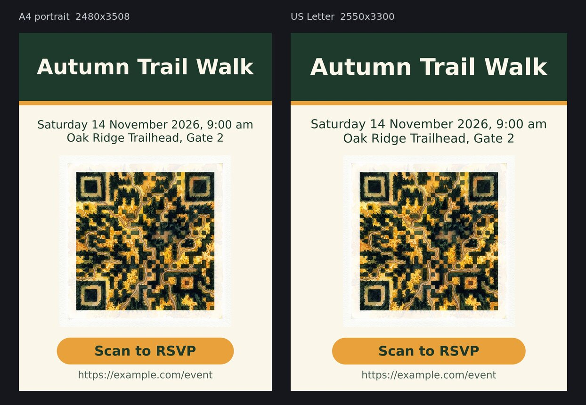

# QR posters

A list of events goes in. Print posters come out. For each row, imgen paints a QR code as a scene that still scans. The script then puts the code on a poster with the title, the date and place, and a call to action. The text is real text, not drawn by the image model. You get A4 (2480x3508) and US Letter (2550x3300) at 300 dpi, as PNG and as PDF.



## Steps

1. Write the list. [`events.tsv`](events.tsv) has one header line and one row per poster. Separate the columns with tab characters, and fill every column:

   | Column | What it is | In the sample |
   |---|---|---|
   | `url` | What the code opens, up to 119 bytes | `https://example.com/event` |
   | `title` | The big title. It also names the output folder | `Autumn Trail Walk` |
   | `details` | The date and the place. Write ` \| ` where the line should break | `Saturday 14 November 2026, 9:00 am \| Oak Ridge Trailhead, Gate 2` |
   | `cta` | The call to action, in the amber pill | `Scan to RSVP` |
   | `scene` | A short picture idea. imgen paints it as a watercolor | `an autumn forest with winding trails` |
   | `dark` | What the dark squares of the code become (`imgen qr --dark`) | `dense evergreen canopy and deep shadow` |
   | `light` | What the light squares become (`imgen qr --light`) | `golden birch leaves and sunlit clearings` |

2. See the cost. This makes no API call. One try is about $0.067, and the script allows 3 tries ($0.20 at most):

   ```text
   IMGEN_ARGS=--dry-run ./make_posters.sh events.tsv out/
   ```

3. Make the posters. imgen prints one line for each try. The output here is shortened:

   ```text
   ./make_posters.sh events.tsv out/
   ```

   ```text
   try 1: 14 of 1089 modules wrong (1.3%), finder 0, separator 0, timing 0: pass
   a4  2480x3508  300 dpi  out/autumn-trail-walk/poster-a4.png
   a4  PDF   595.2 x 841.92 pts (A4)  out/autumn-trail-walk/poster-a4.pdf
   letter  2550x3300  300 dpi  out/autumn-trail-walk/poster-letter.png
   letter  PDF   612 x 792 pts (letter)  out/autumn-trail-walk/poster-letter.pdf
   ```

4. Get a second opinion from another reader, zxing-cpp. This is optional. Use the same URL as in the list:

   ```text
   uv run --with zxing-cpp --with pillow --with numpy python -I check_scan.py 'https://example.com/event' out/autumn-trail-walk/art.png out/autumn-trail-walk/poster-a4.png out/autumn-trail-walk/poster-letter.png
   ```

   ```text
   ok (blur only)  art.png            raw: -  blur 1: -  blur 2: -  blur 3: read  blur 4: read
   ok (blur only)  poster-a4.png      raw: -  blur 1: -  blur 2: read  blur 3: read  blur 4: -
   ok (blur only)  poster-letter.png  raw: -  blur 1: -  blur 2: read  blur 3: read  blur 4: read
   ```

   `ok (raw)` means zxing-cpp read the picture as it is. `ok (blur only)` means it read only a blurred copy, as in the sample. `FAIL` means it read nothing.

5. Scan a printed copy with a phone before you print many.

You need `imgen` with a Gemini key and ImageMagick (`convert` and `identify`, tested with 6.9). Step 4 needs `uv`. The script also uses `pdfinfo` when it is there, to print the PDF page size.

## Outputs

| File | What |
|---|---|
| `out/TITLE/art.png` | The QR art, about 1024 px, from `imgen qr --safe` |
| `out/TITLE/poster-a4.png`, `poster-a4.pdf` | A4 portrait, 2480x3508, 300 dpi |
| `out/TITLE/poster-letter.png`, `poster-letter.pdf` | US Letter, 2550x3300, 300 dpi |

`TITLE` is the title in lowercase with dashes. The folder [`sample/`](sample/) holds small copies from the sample run: the two posters side by side ([`posters.jpg`](sample/posters.jpg)) and the art ([`art-preview.jpg`](sample/art-preview.jpg)). The full-size files are not in this repository (each is 4 to 7 MB).

## The checks

- **imgen's own check.** `imgen qr` reads every module of the art and compares it with the true code. A try passes when fewer than 3% of the modules are wrong, and almost none of the corner and timing patterns. If no try passes, `imgen` exits with 1, and the script stops and builds no poster from that art. The sample run passed on the first try with 1.3% wrong.
- **Page sizes.** The script reads each PNG back and stops if its size is not the one in the table above. It prints the dpi, and the PDF page size from `pdfinfo`: 595.2 x 841.92 pt is A4, and 612 x 792 pt is US Letter.
- **A second reader.** `check_scan.py` asks zxing-cpp to read the art and the posters. It tries the raw picture first, then copies that are shrunk and blurred by 1 to 4 pixels. Read the result lines, and not only the exit code. In the sample run, zxing-cpp could **not** read the raw pixels of any file, but it read every file with a blur of 3 pixels. See the notes.

## Notes and limits

- **zxing-cpp does not read the raw art.** It finds the code, but it looks at one pixel for each square, and the paint texture flips more squares than the error correction can fix. It reads a blurred copy. A phone camera also blurs and shrinks the picture, so a phone may behave like the blurred copy, but this example was not scanned with a phone. imgen's check says the squares of the art match the code. The zxing check says a decoder can get the data back after a blur. A blurred read is not stricter than imgen's check: a lantern scene that imgen rejected also read after a blur of 3 pixels. Neither replaces a scan with a real phone, so do that before you print.
- **Some scenes do not pass.** A first sample for this example, a river valley with floating lanterns, failed all three tries (4.0% to 5.8% of the squares wrong, and the limit is 3%). The script stopped with exit code 1 and made no poster, and that run cost about $0.20. The forest scene in the sample passed on the first try. Try scenes with large dark and light areas, and use `--dark` and `--light` (the `dark` and `light` columns) to say what the squares become. You can raise the tries with `IMGEN_ARGS="-n 5"`.
- **The art is enlarged on the poster.** It is about 1024 px, and it is 1683 px wide on A4. It looks a little soft at full size. For a sharper print, use `IMGEN_ARGS="-r 2K"` (about $0.10 for each try).
- **The PDF is one picture of the page.** The text in it cannot be selected. That is fine for printing.
- **Fonts and colors.** The text uses DejaVu Sans if ImageMagick has it. Set `POSTER_FONT` and `POSTER_FONT_BOLD` to other fonts (names without spaces). The four colors are at the top of the script.
- **Both papers use one layout.** Every size comes from the page width and height, so A4 and US Letter, which have different shapes, both fit. Long titles shrink to fit the band.
- **Same row, same art.** `--cache` is on, so the same row gives the saved art again at no cost, and you can change the layout for free. imgen never overwrites a file, so use a new `OUT_DIR` for each run.
- **The sample is invented.** `example.com` is a reserved name. Use your own link. A short link makes a code with fewer, bigger squares, and that is easier to read.
