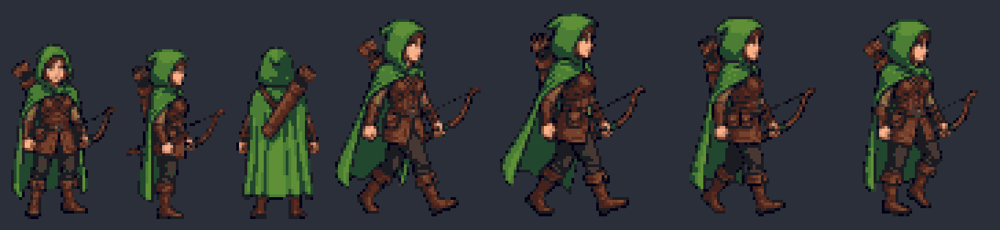
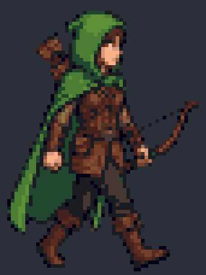
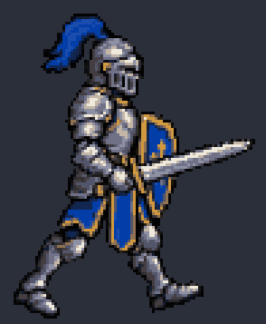

# Animate a game character

Turn one character image into a looping sprite animation: a walk, an idle, an attack. There are two ways:

- **Images only, all imgen** (about $0.50 on Gemini): one approved hero, one turnaround for the directions, one call per pose. imgen keys out the background and snaps every frame to real pixel art in the hero's palette, and `frames.py` lines the frames up.
- **Video** (about $0.40 for Veo, plus the hero): a video model draws real motion, so legs move in the right order. This path is smoother and costs more per try.

## Images only





You need `imgen` with a Gemini key and `uv`. The sample cost $0.62: two heroes, one turnaround, and six pose calls (two poses were made again).

1. Make the hero as a cutout. `--remove-bg` asks for a flat magenta screen and keys it out:

   ```text
   imgen gen -p gemini -r 1K -a 1:1 -n 2 --remove-bg --cache --name hero "16-bit pixel art game sprite of a forest ranger heroine for a top-down action RPG, three-quarter top-down view, full body standing, facing the viewer, green hooded cloak, brown leather tunic, short bow in her hand, quiver on her back, clean dark outline, limited palette, crisp square pixels, no anti-aliasing, centered with plenty of empty space, no shadow, no ground, no text"
   ```

   Pick one and copy it to `hero.png`. This is the anchor: every later call gets it.

2. Make the directions in one image, then cut it apart:

   ```text
   imgen edit -p gemini -r 1K -a 16:9 --remove-bg --cache -i hero.png --name turnaround "A character turnaround sheet of the same character as the reference image: three full-body views side by side in one row, evenly spaced with wide gaps: front view, side view facing right (full profile), back view. Same design, outfit, colors, proportions, dark outline and pixel size in all three, all the same height, feet on the same baseline. 16-bit pixel art, three-quarter top-down RPG sprite style, no shadow, no ground, no text, no labels."
   uv run --with pillow --with numpy python -I frames.py split turnaround.png views --names front,right,back
   ```

3. Make each walk pose in its own call, with the hero and the side view as references, as pixel art in the hero's palette (repeat for the other three poses, with `--name walk2` to `walk4`):

   ```text
   imgen edit -p gemini -r 1K -a 1:1 --remove-bg --cache --pixel 96 --palette hero.png -i hero.png -i views/right.png --name walk1 "The character from the first image, seen from the side facing right exactly as in the second image, walking. Pose, contact: her front leg forward with the heel on the ground, her back leg behind on its toes, the arms swinging opposite to the legs. Same design, outfit, colors, proportions, dark outline and pixel size, the same scale as the second image, full body, centered. 16-bit pixel art, no shadow, no ground, no ground line, no text."
   ```

   The other poses: "passing: the leg nearest the viewer straight under her body, the far leg lifted and passing forward with the knee bent, the body a little higher"; "contact: the far leg forward with the heel on the ground, the leg nearest the viewer behind on its toes, the arms swinging opposite to the legs"; "passing: the far leg straight under her body, the leg nearest the viewer lifted and passing forward with the knee bent, the body a little higher".

4. Line the frames up and make the loop (free):

   ```text
   uv run --with pillow --with numpy python -I frames.py loop out walk1.png walk2.png walk3.png walk4.png --name ranger-walk
   ```

   It writes `frame_NN.png` at native size, `ranger-walk-sheet.png` with `ranger-walk-atlas.json` (TexturePacker-style), and `ranger-walk.gif` and `ranger-walk-dark.gif`, scaled 6x with sharp pixels.

### What makes it work

- **One anchor, never a chain.** Every call gets `hero.png`, the image you approved, not the last result. The pose calls also get the side view, for the angle.
- **All directions in one turnaround.** One view per call failed in testing: asked for "facing right", the model kept the front pose. In one turnaround it drew a true profile.
- **One pose per call.** Many poses in one image come out in the wrong order or with wrong feet.
- **A magenta screen.** `--remove-bg` asks for `#FF00FF`, which games rarely use, so green cloaks and leaves survive. A cutout given as `-i` is put on magenta before it is sent. For pink or purple subjects, use `--remove-bg=green`.
- **Real pixels in one palette.** `--pixel 96` shrinks each image to a true 96-pixel grid with hard edges, and `--palette hero.png` maps every frame to the hero's colors (24 by median cut), so the frames do not shift color.
- **The same scale for every pose.** Make every pose with the same `-r` and `-a`, so `--pixel` shrinks them all by the same amount. `frames.py` never resamples the pixels.
- **Free reruns.** With `--cache`, a command run again with other post flags (another `--pixel` height, another palette) costs nothing: imgen reuses the image it already paid for. The pixel-art views in the sheet above came from the cached turnaround with `--pixel 72 --palette hero.png`.
- **Lined up in code.** `frames.py loop` puts the feet on one baseline and the head and torso on one x. The model moved the body up to 10 pixels between poses.

### Limits

- The two contact poses often look alike, because the model does not show which leg is nearer. The video path below draws real leg motion.
- The turnaround views are a little smaller than the walk frames (about 64 against 70 pixels tall), because the model draws figures smaller in a wide image.
- Do not ask for "feet on one ground line" in a pose prompt: the model drew a line under the feet. `frames.py` lines the feet up anyway.

## Video

Image models cannot draw a smooth animation frame by frame: the poses come out of order and the character drifts. A video model draws motion, so this path animates the character with Veo and then cleans the video into a game-ready loop.



### Steps

1. Make the character with imgen, as a cutout:

   ```text
   imgen gen -p openai -q high -r 1024x1024 -b transparent -f png --name hero \
     "pixel-art knight, side view facing right, full body, 16-bit game sprite style, clean outline, no background, no text"
   ```

2. Animate it on a green screen with Veo (about $0.40 for 4 seconds):

   ```text
   set -a; . ~/.config/imgen/env; set +a
   uv run --with pillow python -I make_video.py hero.png walk.mp4 --character "pixel-art knight"
   ```

3. Turn the video into a sprite loop (free, and you can run it again on the same video at any time):

   ```text
   uv run --with pillow --with numpy --with scipy python -I video2sprite.py walk.mp4 hero.png out/ --style pixel --name knight
   uv run --with pillow --with numpy --with scipy python -I video2sprite.py walk.mp4 hero.png out-smooth/ --style smooth --name knight
   ```

`--style pixel` gives crisp pixel art on a true pixel grid in the hero's own palette. `--style smooth` gives full-color, anti-aliased frames for painted or illustrated characters. Other actions use the same steps with `--action`, for example `--action "breathes in a calm idle loop"` or `--action "raises the sword and strikes forward"`.

### Outputs

| File | What |
|---|---|
| `frame_NNN.png` | Each frame, transparent |
| `NAME.gif` | The loop, transparent |
| `NAME-dark.gif` | The loop on a dark background, for previews |
| `NAME-sheet.png` | All frames in one row |
| `NAME-atlas.json` | TexturePacker-style frame data (hash format) that game engines read |

The script prints the loop it found, for example `26 frames (1.08 s loop from frame 48), seam 0.054 < motion 0.101`. A seam smaller than the motion between two frames means the loop has no visible jump.

### What makes the video path work

- **No black keying.** Only the green screen is removed, so dark pixel-art outlines survive.
- **No position pinning.** Veo keeps the camera still; pinning the feet to a line would add bounce.
- **One shared crop** fits the widest frame, so a swung sword is never cut off.
- **Loop search** compares every frame (legs weighted most) and picks the start and length that flow back into themselves.

Veo draws a new animation on every run. If a result turns, stiffens or swings oddly, run step 2 again; keep every video, since step 3 can rebuild any of them for free.
