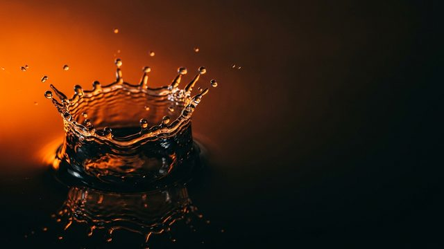
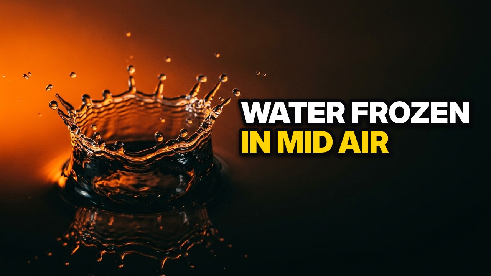

# Video thumbnails from a list

Turn a list of titles and subjects into 1280x720 thumbnails. imgen draws one art plate per row, with the subject on the left and an empty space on the right. The script then sets the title in that space as real text: heavy type, a thick outline and a soft shadow. The words stay exact, and a title edit costs $0, because the plate comes from the cache.

| The plate (no text) | The thumbnail (title drawn locally) |
|---|---|
|  |  |

## Steps

You need `imgen` with a Gemini key (`imgen init`) and `uv`. Run the commands from this folder (`examples/thumbnails`).

1. Write the list as a CSV (or a JSONL file with the same fields). `title` and `subject` are required. `slug` is the output file name; without it, the script makes one from the title:

   ```text
   title,subject,slug
   Water Frozen In Mid Air,"a crown-shaped splash of water frozen in mid air at the moment a droplet hits a dark glossy surface, backlit by warm orange light, extreme close-up high-speed photograph",water-splash
   ```

   `videos.csv` has two rows. The prompt gets only the subject, a layout cue and one shared style. The title is not in it.

2. Check the cost first. This calls no API and writes no file:

   ```text
   uv run --with pillow python -I make_thumbs.py videos.csv thumbs --dry-run
   ```

3. Build the thumbnails (about 10 seconds; each new plate costs about $0.067):

   ```text
   uv run --with pillow python -I make_thumbs.py videos.csv thumbs
   ```

   A first run prints one line per thumbnail. For the sample list it prints this:

   ```text
   tiny-robot: plate new ~$0.067 -> thumbs/tiny-robot.jpg  1280x720  177 KB  3 lines, 84 px  contrast 9.9:1
   water-splash: plate new ~$0.067 -> thumbs/water-splash.jpg  1280x720  130 KB  2 lines, 77 px  contrast 9.7:1
   2 thumbnails in thumbs | plates: 2 new, 0 cached | API cost ~$0.134
   ```

4. Edit a title in `videos.csv` and run step 3 again. Every plate comes from the cache:

   ```text
   tiny-robot: plate cached $0 -> thumbs/tiny-robot.jpg  1280x720  177 KB  3 lines, 84 px  contrast 9.9:1
   water-splash: plate cached $0 -> thumbs/water-splash.jpg  1280x720  130 KB  2 lines, 77 px  contrast 9.7:1
   2 thumbnails in thumbs | plates: 0 new, 2 cached | API cost ~$0.000
   ```

   `imgen history` shows the two jobs at `$0.000`. The new title is on its thumbnail, and the other thumbnail is byte for byte the same.

## Outputs

| File | What |
|---|---|
| `thumbs/SLUG.jpg` | The thumbnail: 1280x720 JPEG, under 2 MB (these samples are 130 and 177 KB) |
| `PLATES/SLUG.jpg` | With `--plates PLATES` only: the plate as imgen made it, 1376x768, about 600 KB |
| `water-splash-plate.jpg` | A 640 px preview of one plate, for this page. The script does not make it |

Each thumbnail keeps the small comment that imgen writes into its images (imgen version, provider and model). It holds no prompt and no path.

## What makes it work

- **The title is not in the plate prompt.** The prompt has the subject, a layout cue and the shared style. imgen caches by the whole request, so a title edit hits the cache.
- **The layout cue makes room.** It asks for the subject in the left third and an empty, dark right side. The title goes in the right half.
- **Two or three words per line.** The script tries every way to cut the title into lines of that size, and keeps the cut that allows the biggest type. The last line is set in the accent color.
- **The type is built to be seen small.** Capitals, a heavy face, an outline of 10% of the type size, and a soft shadow. The script draws all the outlines first, so no outline covers a neighbor line.
- **The corner stays free.** The title box ends 120 px above the bottom edge and 44 px from the right edge, so the duration badge that players draw in the bottom right corner never covers it.
- **Contrast is measured.** The script compares the title with the lightest part of the plate behind it. A dark scrim fades in on the right until the ratio is at least 7:1, and the script prints the result.
- **The size is checked.** The JPEG quality drops from 90 until the file is under 2 MB.

## Notes and limits

- A plate costs money only when its request changes: a new row, or an edit to the subject, `--style` or `--provider`, or a new default model in imgen. A new plate is about $0.067 on Gemini.
- Without a `slug` column, the file name comes from the title. A title edit then writes a new file and leaves the old one in `thumbs/`. It still costs $0. Set `slug` to keep the names fixed.
- The cache lives in `~/.cache/imgen/`. On a new machine, the plates are made again. `--plates DIR` saves them, but the script does not read them back.
- The shared look is the `STYLE` text in `make_thumbs.py`, and the layout cue is `LAYOUT`. Change either and every plate is made again.
- The model decides where the subject ends. Look at each thumbnail before you publish. If a subject reaches into the title area, make it smaller in the `subject` text (for example "small, in the far left corner") and run again.
- A title of three words is set on one line, so its type is smaller. A title of more than 12 words is refused.
- `--case asis` keeps the case you wrote. `--accent '#RRGGBB'` sets the color of the last line.
- Fonts: Inter Display Black if it is installed (free, SIL Open Font License), else Roboto Black, else DejaVu Sans Bold, else the font that comes with Pillow. `--font FILE` picks another.
- Tested with Gemini. Other providers go through `--provider`; the plate request is always `-r 1K -a 16:9`.
