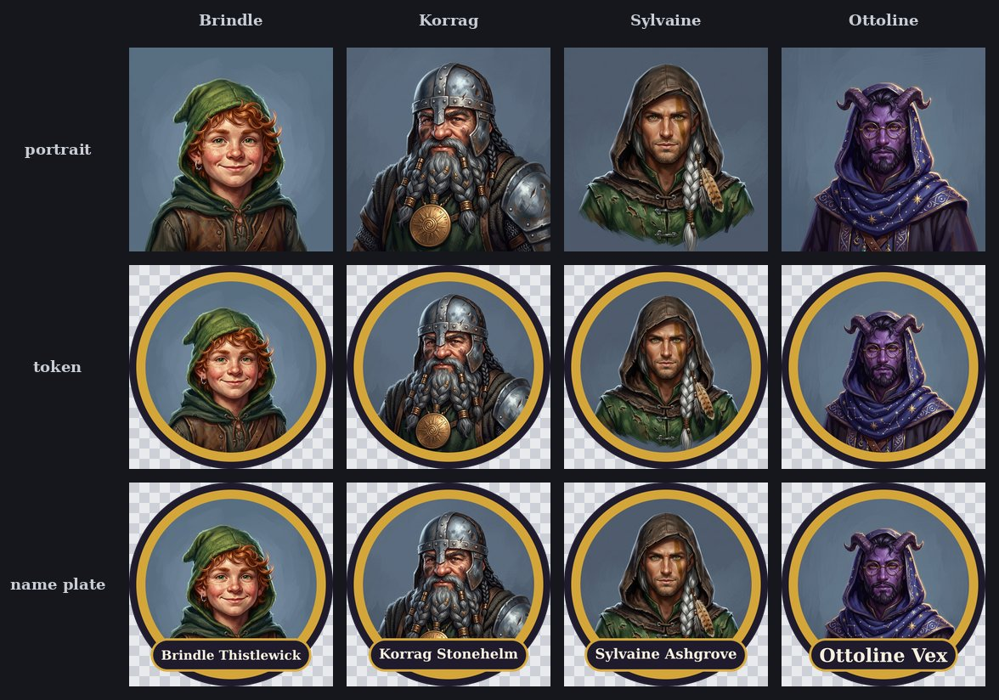

# Round tokens for tabletop games

A list of characters goes in. Round tokens come out. Each token is a portrait cut to a circle, with a two-tone ring and transparent corners, ready to drop on a virtual tabletop map. There are two sizes (280x280 and 512x512), and each size has a plain token and a token with a name plate.



Top row: the portraits from imgen. Middle row: the tokens. Bottom row: the tokens with name plates. The checkerboard shows the parts that are transparent.

## Steps

1. Put your characters in a CSV with the columns `name`, `ancestry`, `class` and `look`. [`characters.csv`](characters.csv) has four invented adventurers. One row:

   ```text
   Brindle Thistlewick,halfling,rogue,"freckled round face, copper curls under a green hooded cap, a lopsided grin, a small silver earring"
   ```

2. See the cost. This makes no API call:

   ```text
   uv run --with pillow python -I make_tokens.py characters.csv out/ --dry-run
   ```

3. Draw the portraits and make the tokens. Four portraits at 1K cost about $0.27:

   ```text
   uv run --with pillow python -I make_tokens.py characters.csv out/
   ```

4. Change the ring colors, the sizes or the font without paying again. `--reuse` keeps the portraits that are already in `out/portraits/` and draws only the missing ones:

   ```text
   uv run --with pillow python -I make_tokens.py characters.csv out/ --reuse --ring-outer "#0b3d2e" --ring-inner "#e8e2d0" --sizes 140,512
   ```

You need `imgen` with a Gemini key, and `uv` (it fetches Pillow for the run).

## What the script does

1. **Jobs.** It reads the CSV and writes `out/jobs.jsonl`: one `imgen batch` job per character, with the prompt and the file name. The prompt asks for a head and shoulders portrait with the face in the center and a wide margin of plain backdrop. The name is not in the prompt, so the model cannot paint a garbled one. [`sample/jobs.jsonl`](sample/jobs.jsonl) is the file from the sample run.
2. **Portraits.** It runs `imgen batch -j 4 -p gemini -r 1K -a 1:1 --style token-art --cache`. All portraits share one named style, so they look like one set. The style is in [`rules.json`](rules.json), and the script points `IMGEN_RULES` at that file. To use the style from any folder, copy its entry into `~/.config/imgen/rules.json`.
3. **Tokens.** Pillow cuts each portrait to a circle and draws the ring: a dark outer band and a gold inner band. Every shape is drawn at 8x and shrunk, so the edges are smooth. The four corners of the square stay transparent.
4. **Name plates.** A second token has a plate with the name. The name is real text from the CSV, drawn with a system serif font. A long name shrinks to fit the plate.
5. **Checks.** The script opens every saved PNG again and checks it (see below). It exits with 1 if any check fails.

## Outputs

| File | What |
|---|---|
| `out/jobs.jsonl` | The batch jobs, one line per character |
| `out/portraits/NAME.jpg` | The portrait, 1024x1024 |
| `out/tokens/NAME-280.png`, `NAME-512.png` | Round token, RGBA, transparent corners |
| `out/tokens/NAME-280-plate.png`, `NAME-512-plate.png` | The same token with a name plate |
| `out/contact-sheet.jpg` | Portrait, token and name plate for every character |

The four sample characters give 4 portraits and 16 tokens. The folder [`sample/`](sample/) holds the small files from the sample run: the contact sheet, the jobs, and two real tokens ([plain](sample/tokens/brindle-thistlewick-280.png) and [with plate](sample/tokens/brindle-thistlewick-280-plate.png)). The portraits and the other tokens are not in this repository.

## The checks

For every token, after it is saved:

- The file is RGBA and has exactly the size you asked for.
- In each of the four corners, a square of 6% of the token size has alpha 0 (fully clear).
- The middle has alpha 255 (fully solid).
- The circle touches all four edges of the canvas.
- The circle is centered: the alpha-weighted center is within 0.25 px of the middle of the canvas.
- The alpha is mirror-symmetric, to within 2 out of 255: the same when flipped left to right, and for plain tokens also top to bottom.
- The ring has the right colors: the script reads the middle of each band at three sides.

A name plate makes the token heavier at the bottom, so for name-plate tokens the script skips the two top-to-bottom checks: the vertical center, and the top-to-bottom flip.

## Notes and limits

- **The ring and the plate cover part of the portrait.** The ring takes about 8% of the radius. The plate covers the lower part, so a belt or an amulet can be hidden. The prompt asks for a wide margin around the head for this reason.
- **The faces vary.** Each character is a separate model call. The shared style keeps the palette and the brush work close, but the framing differs a little from one portrait to the next. To redraw one, change its row (a new prompt is a new call, about $0.067) and run again into a new folder.
- **Fonts.** The plate uses the first of these that your system has: DejaVu Serif Bold, Liberation Serif Bold, FreeSerif Bold, Georgia Bold, Times New Roman Bold. If none is found, Pillow's built-in font is used. Pick one with `--font FILE`.
- **Long names.** A name shrinks to fit, down to a small size. Keep names under about 24 characters.
- **Only built-in providers.** The script points `IMGEN_RULES` at its own `rules.json`, so imgen does not read your `~/.config/imgen/rules.json` for this run. A provider instance that you defined there, such as a local server, is unknown to `--provider`. Add it to a copy of `rules.json` and pass that file with `--rules`.
- **A failed portrait.** The other portraits are kept. The script says which one failed and exits with 1. Run it again with `--reuse` to draw only the missing one.
- **Same CSV, same pictures.** `--cache` is on, so the same CSV, style, provider and resolution give the saved portraits again at no cost. imgen never overwrites a file, so use a new folder or `--reuse`.
- **Your own list.** The characters in the sample are invented. Use any names and looks you like.
