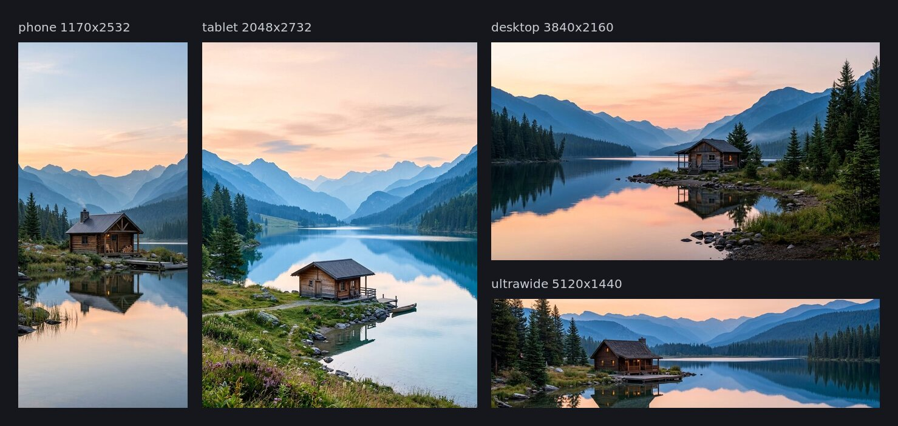

# Wallpaper for every screen

One prompt makes four wallpapers: a phone, a tablet, a desktop and an ultrawide monitor. A wallpaper is not a crop of one picture. A tall phone screen and a wide monitor need different layouts. So the script asks the model for each shape on its own, with the same prompt and the same style, and then resizes each picture to the exact pixel size.



## Steps

1. See what the run costs. This makes no API call:

   ```text
   PROMPT="a small wooden cabin on the shore of a still mountain lake, layered blue ridges behind it, soft peach sky at first light, calm and spacious, the cabin near the center of the frame, no people, no text"
   IMGEN_ARGS=--dry-run ./make_wallpapers.sh "$PROMPT" out/
   ```

2. Make a draft. This is four calls at 1K, about $0.27 in all (the sample here is this draft):

   ```text
   ./make_wallpapers.sh "$PROMPT" out/
   ```

3. Make the finals. Use a new folder, because imgen never overwrites a file. 4K costs about $0.60 for the set:

   ```text
   RES=4K ./make_wallpapers.sh "$PROMPT" out-4k/
   ```

You need `imgen` with a Gemini key, and ImageMagick (`convert` and `identify`, tested with 6.9).

## Outputs

| File | What |
|---|---|
| `out/phone.jpg` | 1170x2532 |
| `out/tablet.jpg` | 2048x2732 |
| `out/desktop.jpg` | 3840x2160 |
| `out/ultrawide.jpg` | 5120x1440 |
| `out/previews/*.jpg` | Small copies, 800 px on the long side. |
| `out/contact-sheet.jpg` | The four previews in one picture, with labels. |

The folder [`sample/`](sample/) holds the previews and the contact sheet from the sample run. The full-size wallpapers are not in this repository. The script reads the size of every file it saves and stops with an error if one is wrong.

## How each screen is made

| Screen | Flags | The model returns (1K) | Final size | Upscale | Cropped away |
|---|---|---|---|---|---|
| phone | `-a 9:16 --style clean-photo --resize 1170x2532:fill` | 768x1376 | 1170x2532 | 1.8x | 17% of the width |
| tablet | `-a 3:4 --style clean-photo --resize 2048x2732:fill` | 896x1200 | 2048x2732 | 2.3x | under 1% |
| desktop | `-a 16:9 --style clean-photo --resize 3840x2160:fill` | 1376x768 | 3840x2160 | 2.8x | under 1% |
| ultrawide | `--profile wallpaper` | 1584x672 | 5120x1440 | 3.2x | 34% of the height |

The `wallpaper` profile asks for 21:9, crops it to 32:9 (5120x1440), and adds the `clean-photo` style. The other three add that style by hand. With `--dry-run` you can see that all four requests carry the same prompt text.

The four calls run at the same time. `--cache` is on, so you can run the same prompt again at no cost.

## Notes and limits

- **The sample is a draft.** At 1K the model draws fewer pixels than the screen has, so imgen enlarges the picture. At full size the desktop (2.8x) and the ultrawide (3.2x) look soft. Use `RES=4K` for wallpapers you keep. The model then draws more pixels, so little or nothing is enlarged.
- **Phones are taller than 9:16.** A 1170x2532 screen is about 19.5:9. The script asks for 9:16, so `fill` crops 17% of the width, from the two sides. Keep the subject in the middle.
- **The ultrawide loses a third of the height.** The model draws 21:9 and the screen is 32:9, so the top and the bottom are cropped. Say where the subject sits, as the sample prompt does ("the cabin near the center of the frame").
- **Grain.** Add `IMGEN_ARGS=--denoise=medium` to smooth leftover grain. imgen saves the model's answer, so you can try denoise levels on the same prompt and `RES` at no cost.
- **Same prompt, same pictures.** With `--cache`, a run with the same prompt and `RES` shows the saved pictures again and costs nothing. Change one word of the prompt, or `RES`, and you pay for four new calls.
- **The style is one word.** `clean-photo` is built in. To use your own look for all four, add a named style to your rules file and change `--style` in the script. See [Configuration](../../docs/configuration.md#styles).
